# afroexpates.com — Spécifications techniques

## 00 — Fondations

> Ce fichier est lu **en premier**. Il fixe le produit, l'architecture, les règles transverses et **le modèle relationnel complet**. Chaque fichier de module (`01-…`, `02-…`) s'appuie dessus et ne les répète pas.
>
> Fichier compagnon : `schema-viewer.html` — le même modèle, interactif, avec les relations dessinées.

---

## 0. Instructions à l'IA qui construit le projet

1. Lis ce fichier en entier avant d'écrire quoi que ce soit. Lis ensuite les modules **dans l'ordre de numérotation**.
2. **Le modèle relationnel de la section 6 est la source de vérité.** Un module peut ajouter des colonnes de détail à ses tables ; il ne renomme jamais une table, ne déplace jamais une relation, ne change jamais un type d'identifiant.
3. **Code en anglais, interface en français.** Identifiants, tables, routes, commentaires : anglais. Tout texte visible par l'utilisateur : français, via des fichiers de traduction. Le glossaire §1.3 donne la correspondance.
4. Pour chaque fonctionnalité, construis dans cet ordre : **données → service → API → interface → tâches planifiées → tests**. Une fonctionnalité n'est terminée que si elle respecte la définition de §12.
5. En cas d'ambiguïté, choisis **l'option la plus protectrice pour la vie privée** et note l'hypothèse dans `docs/decisions.md`. Ne bloque jamais sur une question : avance avec l'hypothèse la plus prudente.
6. Les règles marquées **[RÈGLE DURE]** ne se négocient pas. Un test automatisé doit couvrir chacune.

---

## 1. Le produit en une page

**afroexpates.com** est une plateforme communautaire pour la diaspora africaine en France. Elle accompagne trois moments : **préparer son départ** (le membre est encore en Afrique), **s'installer** (les six premiers mois), **s'intégrer** (ensuite).

Formule : *apparence de réseau social, mécanique de plateforme d'entraide.* Le produit optimise le problème résolu, pas le temps passé.

### 1.1 Les piliers

| Pilier | Rôle |
|---|---|
| **Parcours** (projet d'immigration) | Colonne vertébrale. Checklist d'étapes versionnée qui relie chaque étape aux guides, à l'entraide et aux membres déjà passés par là |
| **Fil d'actualité** | Publications typées, contextualisées par le parcours |
| **Guides et Démarches** | Fiches rédigées et maintenues par les membres, classées par utilité et fraîcheur |
| **Entraide** | Demandes ponctuelles avec état ouvert/résolu |
| **Réseaux** | Groupes par ville, pays d'origine, intérêt |
| **Parrainage** | Un membre installé accompagne un nouveau, dès le pré-départ |
| **Agenda** | Événements physiques locaux |
| **Services** | Logement, emploi, annuaire professionnel |

### 1.2 Principes non négociables

- **[RÈGLE DURE]** Aucune publication n'est jamais faite automatiquement au nom d'un membre. Le système pré-remplit, le membre relit et valide.
- **[RÈGLE DURE]** Aucune pièce d'identité n'est stockée. Le prestataire KYC ne renvoie qu'un statut.
- **[RÈGLE DURE]** Aucune géolocalisation précise n'est collectée. La maille la plus fine est la ville.
- **[RÈGLE DURE]** Un parcours public n'expose que sa progression (étapes, états, durées), aux membres connectés seulement ; jamais ses notes, sa checklist, son équipe ni sa discussion ; jamais un parcours en pause ou arrêté ; jamais indexé par la recherche.
- **[RÈGLE DURE]** Le mot « certifié » n'apparaît nulle part dans l'interface. La plateforme ne vérifie aucun dossier administratif.
- **[RÈGLE DURE]** Aucun état « échoué » sur une étape de parcours. Les états sont : à faire, en cours, franchie, en pause.
- **[RÈGLE DURE]** Aucun rouge dans l'interface.
- **[RÈGLE DURE]** Aucun compteur de vues n'est exposé à personne, sur aucun contenu. Les signets sont privés : aucun compteur d'enregistrements nulle part.
- **[RÈGLE DURE]** Une story ne contient ni lien, ni numéro, ni email ; expirée, elle n'est renvoyée qu'à son auteur et aux membres qui l'ont enregistrée.
- **[RÈGLE DURE]** L'entraide, les guides, le parrainage et les réseaux ne sont jamais derrière un paiement. Payer ne donne aucune priorité sur l'aide reçue.

### 1.3 Glossaire français → code

| Français (interface) | Anglais (code, tables) |
|---|---|
| Membre | `user` |
| Phase (pré-départ, arrivée récente, installé) | `phase` : `PRE_DEPARTURE`, `RECENT_ARRIVAL`, `SETTLED` |
| Parcours / projet | `journey` |
| Type de parcours (modèle) | `journey_template` |
| Étape | `journey_step` (instance) / `step_definition` (bibliothèque) |
| Jalon | publication `post` de type `VICTORY` liée à une `journey_step` |
| « Je suis bloqué » | `blocker_request` |
| Publication du fil | `post` |
| Story (conseil, découverte, information) | `story` |
| Signet / Enregistrer | `bookmark` |
| Guide | `guide` |
| Proposition de mise à jour | `guide_revision_proposal` |
| Demande d'entraide | `help_request` |
| Réseau | `community` |
| Sujet de réseau | `topic` |
| Parrainage / parrain / filleul | `mentorship` / `mentor` / `mentee` |
| Contact | `connection` |
| Événement | `event` |
| Annonce logement | `housing_listing` |
| Offre d'emploi | `job_listing` |
| Fiche professionnelle | `pro_profile` |
| Réputation | `reputation` |
| Signalement | `report` |
| Niveau de vérification | `verification_level` : `L0`, `L1`, `L2` |
| Équipe (admin) | `staff` |

---

## 2. Stack

| Couche | Choix |
|---|---|
| Langage | TypeScript, mode strict, partout |
| Monorepo | pnpm workspaces + Turborepo |
| Front membres | Next.js (App Router) |
| Front admin | Next.js, application séparée, sous-domaine distinct |
| UI | Tailwind CSS + composants maison basés sur Radix UI |
| Données côté client | TanStack Query |
| Formulaires et validation | react-hook-form + zod, schémas partagés front/back |
| PWA | Serwist (service worker, manifeste, push) |
| API | NestJS, REST, OpenAPI généré automatiquement |
| ORM | À choisir à l'implémentation ; le modèle de la section 6 est indépendant de l'ORM |
| Base de données | PostgreSQL 16, extensions `unaccent`, `pg_trgm`, `citext` |
| Cache, files d'attente | Redis + BullMQ |
| Temps réel | WebSocket (socket.io) avec adaptateur Redis |
| Stockage fichiers | Stockage objet compatible S3, **région UE** |
| Traitement d'images | sharp, dans le worker |
| Recherche | PostgreSQL full-text (`tsvector` + `unaccent`) + `pg_trgm` |
| SMS / OTP | Interface abstraite ; implémentation par défaut Twilio Verify |
| Email | Interface abstraite ; implémentation Brevo |
| Push | Web Push (VAPID) |
| KYC | Didit, sessions hébergées, résultat par webhook signé |
| Paiement carte | Stripe Billing |
| Paiement Mobile Money | Interface abstraite ; agrégateur UEMOA à désigner (voir `14-monetisation.md`) |
| Modération IA | API Anthropic, modèle léger |
| Erreurs, suivi | Sentry |
| Journaux | JSON structuré (pino) |
| Tests | Vitest (unitaire), Supertest + Testcontainers (intégration), Playwright (bout en bout) |
| Hébergement | Fournisseur européen, données en UE obligatoire |

**Pourquoi PostgreSQL pour la recherche plutôt qu'un moteur dédié :** le volume V1 (moins de 100 000 documents) ne le justifie pas, et c'est une brique de moins à héberger. L'abstraction `SearchService` permet de migrer vers Meilisearch plus tard sans toucher aux modules.

**Pourquoi pas de PostGIS :** aucune position précise n'est stockée. Les villes portent une latitude et une longitude ; les distances se calculent par formule de haversine.

---

## 3. Architecture

### 3.1 Vue d'ensemble

```
┌──────────────┐   ┌──────────────┐
│  apps/web    │   │  apps/admin  │     Next.js — rendu serveur + client
│  (membres)   │   │  (équipe)    │
└──────┬───────┘   └──────┬───────┘
       │  HTTPS /v1        │  HTTPS /v1/admin
       └─────────┬─────────┘
          ┌──────▼───────┐        ┌───────────────┐
          │   apps/api   │◄──────►│  PostgreSQL   │
          │   (NestJS)   │        └───────────────┘
          └──┬────────┬──┘        ┌───────────────┐
             │        └──────────►│    Redis      │  cache, sessions WS, files
             │                    └───────┬───────┘
             │                    ┌───────▼───────┐
             │                    │ apps/worker   │  tâches, planification, images, envois
             │                    └───────────────┘
             ▼
   Didit · Twilio · Brevo · Stripe · Mobile Money · Anthropic · S3
```

- **apps/api** et **apps/worker** partagent le même code. Le worker démarre le même module racine avec les processeurs de files actifs et le serveur HTTP désactivé (variable `APP_ROLE`).
- **apps/admin** est une application séparée sur `admin.afroexpates.com`, avec authentification renforcée (§7.4).

### 3.2 Arborescence

```
afroexpates/
├── apps/
│   ├── web/           # front membres — zones : auth, onboarding, app (accueil, parcours, entraide, services, agenda, compte, messages)
│   ├── admin/         # front équipe
│   └── api/           # NestJS — un dossier par module (voir 3.3)
├── packages/
│   ├── db/            # schéma, migrations, données de départ
│   ├── shared/        # schémas de validation, enums, matrice de permissions, codes d'erreur
│   ├── ui/            # composants et jetons de design
│   └── config/        # eslint, tsconfig, preset tailwind
├── docs/
│   └── decisions.md   # journal des hypothèses prises par l'IA
├── docker-compose.yml
└── turbo.json
```

### 3.3 Modules de l'API

Un dossier par module, dans cet ordre de numérotation : `auth`, `users`, `verification`, `onboarding`, `places`, `journeys`, `posts`, `guides`, `help`, `communities`, `mentorship`, `connections`, `messaging`, `events`, `housing`, `jobs`, `pros`, `search`, `notifications`, `moderation`, `billing`, `partners`, `analytics`, `admin`.

Chaque module contient : le contrôleur membres, le contrôleur admin si besoin, le service (seul point d'écriture), le dépôt d'accès aux données, les événements de domaine émis, les processeurs de tâches si besoin, le gestionnaire de suppression de compte (§8.6), et ses tests.

**Règles :**
- Un contrôleur n'appelle **que** son service. Un service peut appeler d'autres services, jamais le dépôt d'un autre module.
- Toute écriture passe par un service, qui vérifie les permissions (§7) **avant** d'écrire.
- Les effets de bord (notifications, indexation, réputation) passent par des **événements de domaine** (§9), jamais par des appels directs.

---

## 4. Conventions de code

- TypeScript strict. Aucun `any` ; toute donnée externe est validée avant usage.
- Lint et formatage imposés ; la CI échoue sur un avertissement.
- Nommage : `camelCase` variables et champs, `PascalCase` types et classes, `SCREAMING_SNAKE` enums et constantes, `kebab-case` fichiers et routes. Tables et colonnes en `snake_case`.
- Les schémas de validation vivent dans `packages/shared` et sont la **source unique** : types inférés, validation API, validation formulaires.
- Aucune logique métier dans les composants d'interface : ils appellent des hooks qui appellent le client API.
- Dates en UTC en base (`timestamptz`) ; affichage en `Europe/Paris` par défaut, fuseau du membre si renseigné.
- Montants en **entiers, en centimes** (ou plus petite unité), avec code devise ISO 4217. Jamais de flottant.

---

## 5. Conventions d'API

### 5.1 Généralités

- Préfixe `/v1` pour les membres, `/v1/admin` pour l'équipe. JSON en `camelCase`.
- Authentification par jeton porteur (voir `01-identite.md`).
- Documentation OpenAPI générée, servie hors production.

### 5.2 Format d'erreur

Toute erreur renvoie un objet `error` à trois champs :

| Champ | Contenu |
|---|---|
| `code` | Constante stable en `SCREAMING_SNAKE`, que le front utilise pour choisir son affichage |
| `message` | Français, affichable tel quel |
| `details` | Objet libre : niveau requis, limite atteinte, champ en erreur… |

Codes HTTP : `400` validation, `401` non authentifié, `403` permission, `404` introuvable, `409` conflit d'état, `422` règle métier, `429` limite de débit, `500` erreur serveur.

**Codes transverses :** `VALIDATION_FAILED`, `UNAUTHENTICATED`, `FORBIDDEN`, `NOT_FOUND`, `RATE_LIMITED`, `LEVEL_REQUIRED`, `PLAN_LIMIT_REACHED`, `BLOCKED_RELATIONSHIP`, `ACCOUNT_SUSPENDED`, `CONFLICT`. Chaque module ajoute les siens.

### 5.3 Pagination

Par curseur, jamais par décalage. Chaque liste renvoie `items` et `nextCursor` (null en fin). Limite par défaut 20, maximum 50. Le curseur est opaque et signé.

### 5.4 Idempotence

Les créations sensibles (paiement, publication, demande de parrainage) acceptent un en-tête `Idempotency-Key`. La réponse est conservée 24 h pour la paire (membre, clé).

### 5.5 Limites de débit

Par défaut : 120 requêtes par minute et par membre, 30 écritures par minute. Chaque module précise ses limites propres (OTP, publication, messages).

---

## 6. Modèle relationnel

### 6.1 Règles générales

- **Identifiants :** UUID v7 (triables chronologiquement), générés par l'application.
- **Horodatage :** `created_at`, `updated_at` sur toute table modifiable.
- **Suppression logique :** `deleted_at` sur tout contenu produit par un membre. Les requêtes l'excluent par défaut.
- **Enums :** enums PostgreSQL natifs, réexportés vers le code partagé.
- **Texte des membres :** stocké brut, **jamais du HTML**. Formatage autorisé : sous-ensemble Markdown (gras, italique, listes, liens), rendu par un parseur restreint.
- **Références polymorphes** (`subject_type` + `subject_id`) : uniquement pour `comments`, `reports`, `moderation_cases`, `ai_moderation_checks`, `search_documents`, `audit_logs`, `reputation_events`. Partout ailleurs, clé étrangère explicite.
- **Dénormalisations autorisées** (recalculées par événements, jamais éditées à la main) : `users.verification_level`, `users.plan`, `cities.member_count`, tous les `*_count`, `journeys.progress_pct`, `guides.freshness_score`, `user_stats.*`.

### 6.2 Vue d'ensemble des relations

**Lecture des diagrammes** — notation « patte d'oie » : `||` exactement un · `|o` zéro ou un · `o{` zéro ou plusieurs. Le libellé sur le trait est la colonne portant la clé étrangère. Dans chaque module, les tables d'autres modules apparaissent réduites à leur clé, avec le numéro de leur module.

#### Carte des modules

Chaque flèche indique combien de clés étrangères le module de départ porte vers le module d'arrivée.

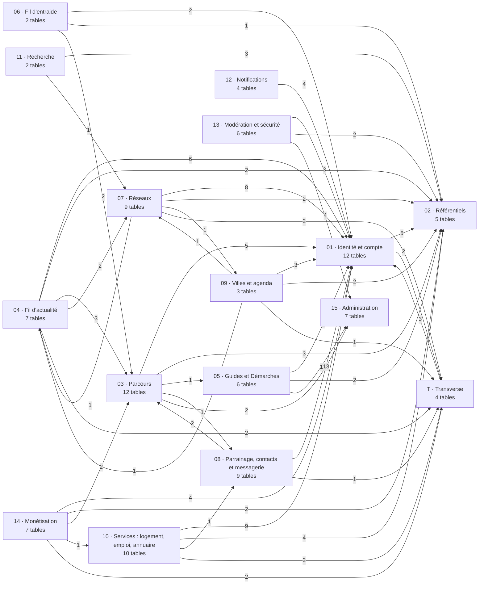

#### Carte complète des tables

```mermaid
flowchart LR
  subgraph M01["01 · Identité et compte"]
    users
    phone_numbers
    otp_challenges
    auth_sessions
    kyc_verifications
    user_profiles
    user_languages
    user_skills
    user_stats
    consents
    account_deletion_requests
    data_exports
  end
  subgraph M02["02 · Référentiels"]
    countries
    cities
    languages
    skills
    professions
  end
  subgraph M03["03 · Parcours"]
    journey_templates
    journey_template_versions
    step_definitions
    template_steps
    step_dependencies
    journeys
    journey_steps
    journey_step_checklist_items
    journey_members
    journey_activities
    blocker_requests
    template_correction_proposals
  end
  subgraph M04["04 · Fil d'actualité"]
    posts
    post_media
    post_reactions
    comments
    stories
    story_reactions
    story_views
  end
  subgraph M05["05 · Guides et Démarches"]
    guides
    guide_versions
    guide_votes
    guide_revision_proposals
    guide_contributors
    guide_outdated_flags
  end
  subgraph M06["06 · Fil d'entraide"]
    help_requests
    help_responses
  end
  subgraph M07["07 · Réseaux"]
    communities
    community_members
    topics
    community_announcements
    polls
    poll_options
    poll_votes
    albums
    album_photos
  end
  subgraph M08["08 · Parrainage, contacts et messagerie"]
    mentor_profiles
    mentorships
    mentorship_reviews
    connections
    connection_requests
    blocks
    conversations
    conversation_members
    messages
  end
  subgraph M09["09 · Villes et agenda"]
    city_tips
    events
    event_attendees
  end
  subgraph M10["10 · Services : logement, emploi, annuaire"]
    housing_listings
    housing_photos
    job_listings
    job_seeker_profiles
    member_recommendations
    pro_profiles
    pro_profile_cities
    pro_recommendations
    pro_contact_logs
    saved_alerts
  end
  subgraph M11["11 · Recherche"]
    search_documents
    search_zero_results
  end
  subgraph M12["12 · Notifications"]
    notifications
    notification_preferences
    push_subscriptions
    outbound_messages
  end
  subgraph M13["13 · Modération et sécurité"]
    reports
    moderation_cases
    moderation_actions
    sanctions
    scam_alerts
    ai_moderation_checks
  end
  subgraph M14["14 · Monétisation"]
    plans
    subscriptions
    payments
    usage_counters
    partners
    partner_placements
    affiliate_clicks
  end
  subgraph M15["15 · Administration"]
    staff_users
    staff_sessions
    audit_logs
    feature_flags
    static_pages
    announcements
    system_settings
  end
  subgraph MT["T · Transverse"]
    media_assets
    domain_events
    bookmarks
    reputation_events
  end
  users --> media_assets
  users --> countries
  users --> cities
  phone_numbers --> users
  phone_numbers --> countries
  auth_sessions --> users
  kyc_verifications --> users
  user_profiles --> users
  user_languages --> users
  user_languages --> languages
  user_skills --> users
  user_skills --> skills
  user_stats --> users
  consents --> users
  account_deletion_requests --> users
  data_exports --> users
  data_exports --> media_assets
  cities --> countries
  journey_template_versions --> journey_templates
  journey_template_versions --> countries
  journey_template_versions --> staff_users
  step_definitions --> guides
  template_steps --> journey_template_versions
  template_steps --> step_definitions
  step_dependencies --> journey_template_versions
  step_dependencies --> template_steps
  journeys --> users
  journeys --> journey_template_versions
  journeys --> countries
  journeys --> cities
  journeys --> journey_steps
  journeys --> conversations
  journey_steps --> journeys
  journey_steps --> template_steps
  journey_steps --> step_definitions
  journey_step_checklist_items --> journey_steps
  journey_members --> journeys
  journey_members --> users
  journey_activities --> journeys
  journey_activities --> users
  journey_activities --> journey_steps
  blocker_requests --> journeys
  blocker_requests --> journey_steps
  template_correction_proposals --> journey_template_versions
  template_correction_proposals --> step_definitions
  template_correction_proposals --> users
  template_correction_proposals --> staff_users
  posts --> users
  posts --> cities
  posts --> communities
  posts --> journeys
  posts --> journey_steps
  posts --> topics
  post_media --> posts
  post_media --> media_assets
  post_reactions --> posts
  post_reactions --> users
  comments --> users
  stories --> users
  stories --> media_assets
  stories --> cities
  stories --> step_definitions
  story_reactions --> stories
  story_reactions --> users
  story_views --> stories
  story_views --> users
  guides --> users
  guides --> countries
  guides --> cities
  guides --> guide_versions
  guide_versions --> guides
  guide_versions --> users
  guide_versions --> guide_revision_proposals
  guide_votes --> guides
  guide_votes --> users
  guide_revision_proposals --> guides
  guide_revision_proposals --> users
  guide_revision_proposals --> guide_versions
  guide_revision_proposals --> staff_users
  guide_contributors --> guides
  guide_contributors --> users
  guide_outdated_flags --> guides
  guide_outdated_flags --> users
  help_requests --> users
  help_requests --> cities
  help_requests --> journey_steps
  help_requests --> blocker_requests
  help_requests --> help_responses
  help_responses --> help_requests
  help_responses --> users
  communities --> cities
  communities --> countries
  communities --> users
  communities --> media_assets
  community_members --> communities
  community_members --> users
  topics --> communities
  topics --> users
  topics --> posts
  community_announcements --> communities
  community_announcements --> users
  polls --> communities
  polls --> users
  poll_options --> polls
  poll_votes --> poll_options
  poll_votes --> users
  albums --> communities
  albums --> events
  albums --> users
  album_photos --> albums
  album_photos --> media_assets
  album_photos --> users
  mentor_profiles --> users
  mentorships --> users
  mentorships --> journeys
  mentorships --> conversations
  mentorship_reviews --> mentorships
  mentorship_reviews --> users
  connections --> users
  connection_requests --> users
  blocks --> users
  conversations --> journeys
  conversations --> mentorships
  conversation_members --> conversations
  conversation_members --> users
  messages --> conversations
  messages --> users
  messages --> media_assets
  city_tips --> cities
  city_tips --> users
  city_tips --> stories
  events --> users
  events --> communities
  events --> cities
  events --> media_assets
  event_attendees --> events
  event_attendees --> users
  housing_listings --> users
  housing_listings --> cities
  housing_photos --> housing_listings
  housing_photos --> media_assets
  job_listings --> users
  job_listings --> cities
  job_seeker_profiles --> users
  member_recommendations --> users
  member_recommendations --> job_listings
  pro_profiles --> users
  pro_profiles --> professions
  pro_profiles --> media_assets
  pro_profile_cities --> pro_profiles
  pro_profile_cities --> cities
  pro_recommendations --> pro_profiles
  pro_recommendations --> users
  pro_recommendations --> connections
  pro_contact_logs --> pro_profiles
  pro_contact_logs --> users
  saved_alerts --> users
  search_documents --> cities
  search_documents --> countries
  search_documents --> communities
  search_zero_results --> cities
  notifications --> users
  notification_preferences --> users
  push_subscriptions --> users
  outbound_messages --> users
  reports --> users
  reports --> moderation_cases
  moderation_cases --> users
  moderation_cases --> staff_users
  moderation_actions --> moderation_cases
  moderation_actions --> staff_users
  sanctions --> users
  sanctions --> staff_users
  sanctions --> moderation_cases
  scam_alerts --> cities
  scam_alerts --> countries
  scam_alerts --> staff_users
  scam_alerts --> moderation_cases
  subscriptions --> users
  subscriptions --> pro_profiles
  subscriptions --> plans
  payments --> users
  payments --> subscriptions
  payments --> media_assets
  usage_counters --> users
  partners --> media_assets
  partner_placements --> partners
  partner_placements --> step_definitions
  partner_placements --> countries
  affiliate_clicks --> partner_placements
  affiliate_clicks --> users
  affiliate_clicks --> journey_steps
  staff_sessions --> staff_users
  static_pages --> staff_users
  announcements --> staff_users
  system_settings --> staff_users
  media_assets --> users
  bookmarks --> users
  reputation_events --> users
```

### 6.3 Tables par module

Le modèle compte **105 tables** réparties en 16 modules. Le viewer interactif `schema-viewer.html` présente les mêmes tables avec les relations dessinées.

**Colonnes communes** — pour ne pas les répéter, chaque table indique son socle :

| Socle | Colonnes |
|---|---|
| `std` | `id` uuid PK · `created_at` · `updated_at` |
| `std+soft` | `std` + `deleted_at` (suppression logique) |
| `pk_user` | `user_id` uuid PK → `users.id` · `created_at` · `updated_at` |
| `append` | `id` uuid PK · `created_at` — table en ajout seul |
| `none` | aucune |

**Légende des drapeaux** — `PK` clé primaire · `NN` non nul · `UQ` unique · `IX` indexé · `→` clé étrangère.


### Module 01 — Identité et compte

*Compte, téléphone, KYC, profil, consentements, suppression.*

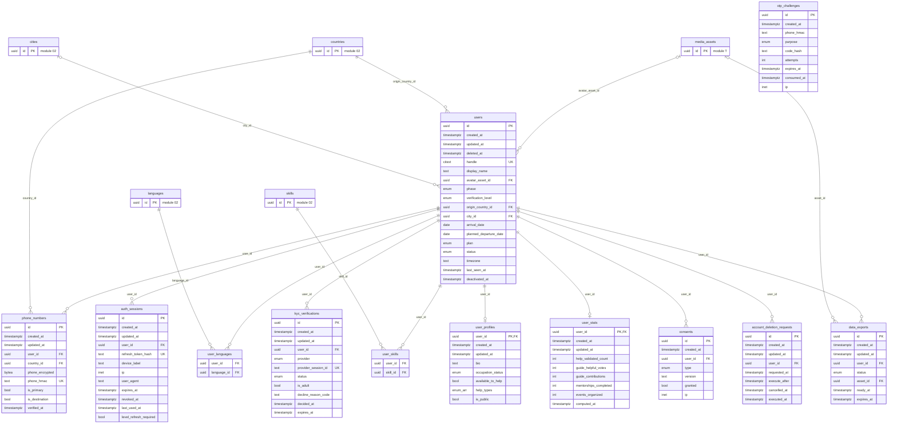


#### `users` — socle `std+soft`

Le compte d'un membre. Une ligne par personne.

| Colonne | Type | Drapeaux | Référence | Note |
|---|---|---|---|---|
| `handle` | citext | NN UQ |  | Pseudo public, insensible à la casse |
| `display_name` | text | NN |  |  |
| `avatar_asset_id` | uuid |  | → `media_assets.id` |  |
| `phase` | enum | NN IX |  | PRE_DEPARTURE · RECENT_ARRIVAL · SETTLED |
| `verification_level` | enum | NN IX |  | L0 · L1 · L2 — dénormalisé, recalculé sur événement |
| `origin_country_id` | uuid | NN IX | → `countries.id` |  |
| `city_id` | uuid | IX | → `cities.id` | Ville de résidence, ou ville cible si pré-départ |
| `arrival_date` | date |  |  | Renseignée si arrivée |
| `planned_departure_date` | date |  |  | Renseignée si pré-départ |
| `plan` | enum | NN |  | FREE · PREMIUM — dénormalisé depuis subscriptions |
| `status` | enum | NN IX |  | ACTIVE · DEACTIVATED · SUSPENDED · DELETION_PENDING · DELETED |
| `timezone` | text | NN |  | Défaut Europe/Paris |
| `last_seen_at` | timestamptz |  |  |  |
| `deactivated_at` | timestamptz |  |  |  |


#### `phone_numbers` — socle `std`

Numéros de téléphone vérifiés d'un membre. Le numéro n'est jamais stocké en clair.

| Colonne | Type | Drapeaux | Référence | Note |
|---|---|---|---|---|
| `user_id` | uuid | NN IX | → `users.id` |  |
| `country_id` | uuid | NN | → `countries.id` | Pays de l'indicatif |
| `phone_encrypted` | bytea | NN |  | AES-256-GCM |
| `phone_hmac` | text | NN UQ |  | HMAC-SHA256 : unicité et recherche |
| `is_primary` | bool | NN |  |  |
| `is_destination` | bool | NN |  | Vrai si l'indicatif est celui d'un pays de destination actif → condition du niveau L2 |
| `verified_at` | timestamptz | NN |  |  |


#### `otp_challenges` — socle `append`

Défis OTP en cours. Purgés après 24 h.

| Colonne | Type | Drapeaux | Référence | Note |
|---|---|---|---|---|
| `phone_hmac` | text | NN IX |  |  |
| `purpose` | enum | NN |  | SIGNUP · LOGIN · ADD_PHONE · DELETE_ACCOUNT |
| `code_hash` | text | NN |  |  |
| `attempts` | int | NN |  | Max 5 |
| `expires_at` | timestamptz | NN |  |  |
| `consumed_at` | timestamptz |  |  |  |
| `ip` | inet |  |  |  |


#### `auth_sessions` — socle `std`

Sessions de connexion (jeton de rafraîchissement).

| Colonne | Type | Drapeaux | Référence | Note |
|---|---|---|---|---|
| `user_id` | uuid | NN IX | → `users.id` |  |
| `refresh_token_hash` | text | NN UQ |  |  |
| `device_label` | text |  |  |  |
| `ip` | inet |  |  |  |
| `user_agent` | text |  |  |  |
| `expires_at` | timestamptz | NN |  |  |
| `revoked_at` | timestamptz |  |  |  |
| `last_used_at` | timestamptz |  |  |  |
| `level_refresh_required` | bool | NN |  | Vrai après changement de niveau : force un nouveau jeton d'accès |


#### `kyc_verifications` — socle `std`

Sessions de vérification d'identité (Didit). Aucune donnée d'identité conservée.

| Colonne | Type | Drapeaux | Référence | Note |
|---|---|---|---|---|
| `user_id` | uuid | NN IX | → `users.id` |  |
| `provider` | enum | NN |  | DIDIT |
| `provider_session_id` | text | NN UQ |  |  |
| `status` | enum | NN IX |  | NOT_STARTED · IN_PROGRESS · APPROVED · DECLINED · IN_REVIEW · ABANDONED · EXPIRED |
| `is_adult` | bool |  |  | Seule donnée dérivée conservée |
| `decline_reason_code` | text |  |  | Code fournisseur, sans détail |
| `decided_at` | timestamptz |  |  |  |
| `expires_at` | timestamptz |  |  |  |


#### `user_profiles` — socle `pk_user`

Informations de profil éditables.

| Colonne | Type | Drapeaux | Référence | Note |
|---|---|---|---|---|
| `bio` | text |  |  | ≤ 500 caractères |
| `occupation_status` | enum | NN |  | STUDENT · EMPLOYEE · ENTREPRENEUR · JOB_SEEKER · OTHER |
| `available_to_help` | bool | NN IX |  |  |
| `help_types` | enum[] |  |  | PAPERWORK · HOUSING · JOB · WELCOME · OTHER |
| `is_public` | bool | NN |  | Profil visible hors connexion (par défaut non) |


#### `user_languages` — socle `none`

Langues parlées.

| Colonne | Type | Drapeaux | Référence | Note |
|---|---|---|---|---|
| `user_id` | uuid | NN | → `users.id` |  |
| `language_id` | uuid | NN | → `languages.id` |  |

> Unicité : (`user_id`, `language_id`)


#### `user_skills` — socle `none`

Compétences déclarées.

| Colonne | Type | Drapeaux | Référence | Note |
|---|---|---|---|---|
| `user_id` | uuid | NN | → `users.id` |  |
| `skill_id` | uuid | NN | → `skills.id` |  |

> Unicité : (`user_id`, `skill_id`)


#### `user_stats` — socle `pk_user`

Compteurs de réputation. Maintenus par les événements de réputation, jamais édités à la main.

| Colonne | Type | Drapeaux | Référence | Note |
|---|---|---|---|---|
| `help_validated_count` | int | NN |  |  |
| `guide_helpful_votes` | int | NN |  |  |
| `guide_contributions` | int | NN |  |  |
| `mentorships_completed` | int | NN |  |  |
| `events_organized` | int | NN |  |  |
| `computed_at` | timestamptz | NN |  |  |


#### `consents` — socle `append`

Consentements horodatés (preuve RGPD).

| Colonne | Type | Drapeaux | Référence | Note |
|---|---|---|---|---|
| `user_id` | uuid | NN IX | → `users.id` |  |
| `type` | enum | NN |  | TERMS · PRIVACY · MARKETING_EMAIL · JOURNEY_VISIBILITY |
| `version` | text | NN |  | Version du document accepté |
| `granted` | bool | NN |  |  |
| `ip` | inet |  |  |  |


#### `account_deletion_requests` — socle `std`

Demandes de suppression avec délai de rétractation.

| Colonne | Type | Drapeaux | Référence | Note |
|---|---|---|---|---|
| `user_id` | uuid | NN IX | → `users.id` |  |
| `requested_at` | timestamptz | NN |  |  |
| `execute_after` | timestamptz | NN |  | requested_at + 7 jours |
| `cancelled_at` | timestamptz |  |  |  |
| `executed_at` | timestamptz |  |  |  |


#### `data_exports` — socle `std`

Exports RGPD des données d'un membre.

| Colonne | Type | Drapeaux | Référence | Note |
|---|---|---|---|---|
| `user_id` | uuid | NN IX | → `users.id` |  |
| `status` | enum | NN |  | PENDING · READY · EXPIRED |
| `asset_id` | uuid |  | → `media_assets.id` |  |
| `ready_at` | timestamptz |  |  |  |
| `expires_at` | timestamptz |  |  | Lien valable 7 jours |


### Module 02 — Référentiels

*Données de référence administrées : pays, villes, langues, compétences, métiers.*

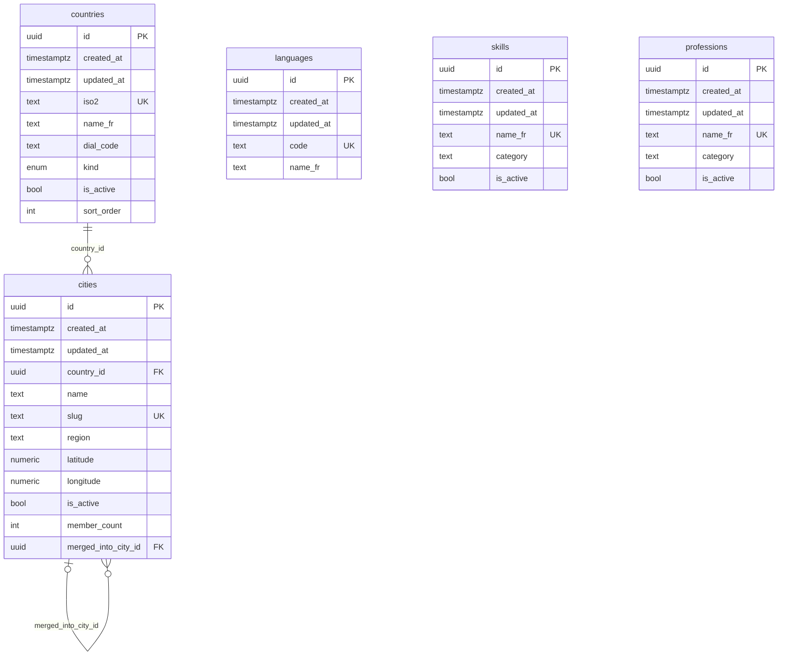


#### `countries` — socle `std`

Pays d'origine et de destination.

| Colonne | Type | Drapeaux | Référence | Note |
|---|---|---|---|---|
| `iso2` | text | NN UQ |  |  |
| `name_fr` | text | NN |  |  |
| `dial_code` | text | NN |  | Ex. +229 |
| `kind` | enum | NN |  | ORIGIN · DESTINATION · BOTH |
| `is_active` | bool | NN IX |  | Lancement mono-pays : un seul ORIGIN actif |
| `sort_order` | int | NN |  |  |


#### `cities` — socle `std`

Villes. Maille géographique la plus fine de la plateforme.

| Colonne | Type | Drapeaux | Référence | Note |
|---|---|---|---|---|
| `country_id` | uuid | NN IX | → `countries.id` |  |
| `name` | text | NN |  |  |
| `slug` | text | NN UQ |  |  |
| `region` | text |  |  |  |
| `latitude` | numeric | NN |  |  |
| `longitude` | numeric | NN |  |  |
| `is_active` | bool | NN IX |  |  |
| `member_count` | int | NN |  | Dénormalisé, recalculé quotidiennement |
| `merged_into_city_id` | uuid |  | → `cities.id` | Fusion de doublons |


#### `languages` — socle `std`

Langues proposées au profil.

| Colonne | Type | Drapeaux | Référence | Note |
|---|---|---|---|---|
| `code` | text | NN UQ |  |  |
| `name_fr` | text | NN |  |  |


#### `skills` — socle `std`

Compétences proposées au profil.

| Colonne | Type | Drapeaux | Référence | Note |
|---|---|---|---|---|
| `name_fr` | text | NN UQ |  |  |
| `category` | text |  |  |  |
| `is_active` | bool | NN |  |  |


#### `professions` — socle `std`

Métiers de l'annuaire professionnel.

| Colonne | Type | Drapeaux | Référence | Note |
|---|---|---|---|---|
| `name_fr` | text | NN UQ |  |  |
| `category` | text |  |  |  |
| `is_active` | bool | NN |  |  |


### Module 03 — Parcours

*Modèles versionnés administrés par l'équipe ; parcours instanciés et modifiables par les membres.*

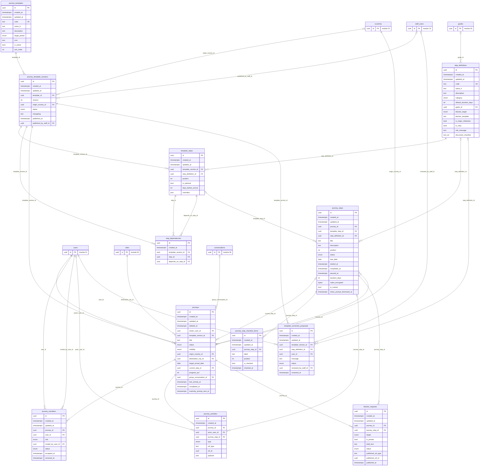


#### `journey_templates` — socle `std`

Type de parcours (Études, Travail, Regroupement familial, Installation…).

| Colonne | Type | Drapeaux | Référence | Note |
|---|---|---|---|---|
| `code` | text | NN UQ |  | STUDIES · WORK · FAMILY · SETTLEMENT · … |
| `name_fr` | text | NN |  |  |
| `description` | text |  |  |  |
| `target_phase` | enum | NN |  | Phase attendue à la création |
| `icon` | text |  |  |  |
| `is_active` | bool | NN |  |  |
| `sort_order` | int | NN |  |  |


#### `journey_template_versions` — socle `std`

Version publiée d'un type. Un parcours en cours reste figé sur sa version.

| Colonne | Type | Drapeaux | Référence | Note |
|---|---|---|---|---|
| `template_id` | uuid | NN IX | → `journey_templates.id` |  |
| `version` | int | NN |  |  |
| `origin_country_id` | uuid | IX | → `countries.id` | Null = version générique ; sinon déclinaison par pays d'origine |
| `status` | enum | NN IX |  | DRAFT · PUBLISHED · ARCHIVED |
| `changelog` | text |  |  |  |
| `published_at` | timestamptz |  |  |  |
| `published_by_staff_id` | uuid |  | → `staff_users.id` |  |

> Unicité : (`template_id`, `version`, `origin_country_id`)


#### `step_definitions` — socle `std`

Bibliothèque d'étapes réutilisables entre types.

| Colonne | Type | Drapeaux | Référence | Note |
|---|---|---|---|---|
| `code` | text | NN UQ |  | Ex. OPEN_BANK_ACCOUNT |
| `name_fr` | text | NN |  |  |
| `description` | text |  |  |  |
| `category` | enum | NN |  | PRE_DEPARTURE · ARRIVAL · SETTLEMENT |
| `default_duration_days` | int |  |  | Durée indicative, corrigée par les délais réels observés |
| `guide_id` | uuid |  | → `guides.id` | Guide lié affiché sur l'étape |
| `blocker_target` | enum | NN |  | HELP · HOUSING · JOBS · MENTORSHIP · NONE — routage de « Je suis bloqué » |
| `blocker_template` | text |  |  | Gabarit pré-rempli, variables {ville} {echeance} {etape} |
| `is_major_milestone` | bool | NN |  | Déclenche la proposition de partage |
| `is_risky` | bool | NN |  | Étape à fort taux de blocage |
| `risk_message` | text |  |  |  |
| `document_checklist` | text[] |  |  | Libellés cochables, aucun stockage de document |


#### `template_steps` — socle `std`

Étapes composant une version de type, ordonnées.

| Colonne | Type | Drapeaux | Référence | Note |
|---|---|---|---|---|
| `template_version_id` | uuid | NN IX | → `journey_template_versions.id` |  |
| `step_definition_id` | uuid | NN | → `step_definitions.id` |  |
| `position` | int | NN |  |  |
| `is_optional` | bool | NN |  |  |
| `days_before_arrival` | int |  |  | Rétro-planning : l'étape doit être franchie N jours avant la date d'arrivée cible |
| `overrides` | json |  |  | Surcharges locales de la définition (nom, gabarit) |

> Unicité : (`template_version_id`, `position`)


#### `step_dependencies` — socle `append`

Dépendances entre étapes d'une même version (pas de visa sans admission).

| Colonne | Type | Drapeaux | Référence | Note |
|---|---|---|---|---|
| `template_version_id` | uuid | NN IX | → `journey_template_versions.id` |  |
| `step_id` | uuid | NN | → `template_steps.id` |  |
| `depends_on_step_id` | uuid | NN | → `template_steps.id` |  |

> Unicité : (`step_id`, `depends_on_step_id`)


#### `journeys` — socle `std+soft`

Le parcours d'un membre. Objet central de la plateforme.

| Colonne | Type | Drapeaux | Référence | Note |
|---|---|---|---|---|
| `owner_user_id` | uuid | NN IX | → `users.id` |  |
| `template_version_id` | uuid | NN IX | → `journey_template_versions.id` |  |
| `title` | text | NN |  | Nom donné par le membre — affiché dans la navigation |
| `status` | enum | NN IX |  | ACTIVE · PAUSED · COMPLETED · ABANDONED · ARCHIVED |
| `visibility` | enum | NN IX |  | PRIVATE · SHARED (invités) · PUBLIC (progression visible des membres connectés — jamais notes, checklist, équipe ; jamais en pause ou arrêté) |
| `origin_country_id` | uuid | NN | → `countries.id` |  |
| `destination_city_id` | uuid | NN IX | → `cities.id` |  |
| `target_arrival_date` | date |  |  | Pivot du rétro-planning |
| `current_step_id` | uuid |  | → `journey_steps.id` |  |
| `progress_pct` | int | NN |  | Dénormalisé |
| `group_conversation_id` | uuid |  | → `conversations.id` | Créée à l'ouverture |
| `last_activity_at` | timestamptz | NN IX |  |  |
| `completed_at` | timestamptz |  |  |  |
| `inactivity_prompt_sent_at` | timestamptz |  |  | Relance unique après 60 jours |


#### `journey_steps` — socle `std`

Instance d'étape dans un parcours. Modifiable par le membre.

| Colonne | Type | Drapeaux | Référence | Note |
|---|---|---|---|---|
| `journey_id` | uuid | NN IX | → `journeys.id` |  |
| `template_step_id` | uuid |  | → `template_steps.id` | Null si étape ajoutée par le membre |
| `step_definition_id` | uuid |  | → `step_definitions.id` |  |
| `title` | text | NN |  |  |
| `description` | text |  |  |  |
| `position` | int | NN |  |  |
| `status` | enum | NN IX |  | TODO · IN_PROGRESS · DONE · PAUSED — jamais d'échec |
| `due_date` | date | IX |  | Calculée par le rétro-planning ou saisie |
| `started_at` | timestamptz |  |  |  |
| `completed_at` | timestamptz |  |  |  |
| `paused_at` | timestamptz |  |  |  |
| `duration_days` | int |  |  | Réel, calculé à la clôture — alimente les statistiques |
| `notes_encrypted` | bytea |  |  | Notes personnelles, chiffrées |
| `is_custom` | bool | NN |  |  |
| `share_prompt_dismissed_at` | timestamptz |  |  | Le membre a décliné le partage de ce jalon — ne plus proposer |

> Unicité : (`journey_id`, `position`)


#### `journey_step_checklist_items` — socle `std`

Checklist de documents d'une étape (libellés cochables).

| Colonne | Type | Drapeaux | Référence | Note |
|---|---|---|---|---|
| `journey_step_id` | uuid | NN IX | → `journey_steps.id` |  |
| `label` | text | NN |  |  |
| `position` | int | NN |  |  |
| `is_checked` | bool | NN |  |  |
| `checked_at` | timestamptz |  |  |  |


#### `journey_members` — socle `std`

Équipe du parcours : observateurs et accompagnants.

| Colonne | Type | Drapeaux | Référence | Note |
|---|---|---|---|---|
| `journey_id` | uuid | NN IX | → `journeys.id` |  |
| `user_id` | uuid | NN IX | → `users.id` |  |
| `role` | enum | NN |  | OBSERVER (consulte) · SUPPORTER (commente) |
| `invited_by_user_id` | uuid | NN | → `users.id` |  |
| `status` | enum | NN |  | INVITED · ACTIVE · REMOVED |
| `accepted_at` | timestamptz |  |  |  |
| `removed_at` | timestamptz |  |  |  |

> Unicité : (`journey_id`, `user_id`)


#### `journey_activities` — socle `append`

Journal du parcours. Base de l'export et de la conversion en guide.

| Colonne | Type | Drapeaux | Référence | Note |
|---|---|---|---|---|
| `journey_id` | uuid | NN IX | → `journeys.id` |  |
| `actor_user_id` | uuid |  | → `users.id` |  |
| `journey_step_id` | uuid |  | → `journey_steps.id` |  |
| `type` | enum | NN |  | STEP_STARTED · STEP_DONE · STEP_PAUSED · BLOCKER_PUBLISHED · HELP_RECEIVED · MEMBER_JOINED · MILESTONE_SHARED · NOTE |
| `ref_type` | text |  |  |  |
| `ref_id` | uuid |  |  |  |
| `payload` | json |  |  |  |


#### `blocker_requests` — socle `std`

Trace d'un « Je suis bloqué » : brouillon pré-rempli, puis publication validée par le membre.

| Colonne | Type | Drapeaux | Référence | Note |
|---|---|---|---|---|
| `journey_id` | uuid | NN IX | → `journeys.id` |  |
| `journey_step_id` | uuid | NN IX | → `journey_steps.id` |  |
| `target` | enum | NN |  | HELP · HOUSING · JOBS · MENTORSHIP |
| `is_private` | bool | NN |  | Vrai : envoyé aux accompagnants et parrain seulement |
| `draft_text` | text | NN |  |  |
| `status` | enum | NN |  | DRAFT · PUBLISHED · CANCELLED |
| `published_ref_type` | text |  |  | help_requests · housing_listings · … |
| `published_ref_id` | uuid |  |  |  |
| `published_at` | timestamptz |  |  |  |


#### `template_correction_proposals` — socle `std`

Corrections de modèle proposées par les membres, validées par l'équipe.

| Colonne | Type | Drapeaux | Référence | Note |
|---|---|---|---|---|
| `template_version_id` | uuid | NN IX | → `journey_template_versions.id` |  |
| `step_definition_id` | uuid |  | → `step_definitions.id` |  |
| `user_id` | uuid | NN | → `users.id` |  |
| `message` | text | NN |  |  |
| `status` | enum | NN IX |  | PENDING · ACCEPTED · REJECTED |
| `reviewed_by_staff_id` | uuid |  | → `staff_users.id` |  |
| `reviewed_at` | timestamptz |  |  |  |


### Module 04 — Fil d'actualité

*Publications typées, réactions à vocabulaire variable, commentaires, stories 24 h (conseil · découverte · information). Un jalon est une publication Victoire liée à une étape.*

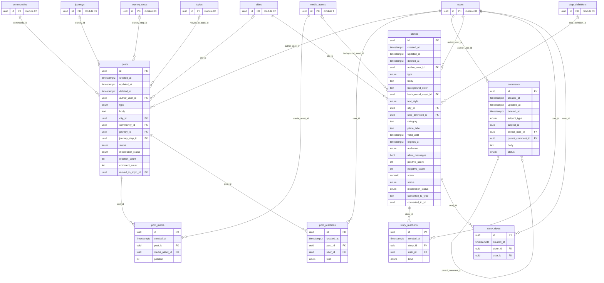


#### `posts` — socle `std+soft`

Publication du fil global ou du fil d'un réseau.

| Colonne | Type | Drapeaux | Référence | Note |
|---|---|---|---|---|
| `author_user_id` | uuid | NN IX | → `users.id` |  |
| `type` | enum | NN IX |  | VICTORY · QUESTION · INFO · DISCUSSION — le conseil est une story |
| `body` | text | NN |  | Markdown restreint |
| `city_id` | uuid | IX | → `cities.id` | Contexte géographique, sert au tri par proximité |
| `community_id` | uuid | IX | → `communities.id` | Null = fil global ; sinon fil du réseau |
| `journey_id` | uuid |  | → `journeys.id` | Contexte « Parcours Études » |
| `journey_step_id` | uuid | IX | → `journey_steps.id` | Victoire liée à une étape franchie → encart « Étape franchie » ; null = réussite personnelle |
| `status` | enum | NN IX |  | PUBLISHED · HIDDEN · REMOVED |
| `moderation_status` | enum | NN |  | PENDING · CLEARED · FLAGGED |
| `reaction_count` | int | NN |  |  |
| `comment_count` | int | NN |  |  |
| `moved_to_topic_id` | uuid |  | → `topics.id` | Question déplacée vers un réseau |


#### `post_media` — socle `append`

Images jointes à une publication.

| Colonne | Type | Drapeaux | Référence | Note |
|---|---|---|---|---|
| `post_id` | uuid | NN IX | → `posts.id` |  |
| `media_asset_id` | uuid | NN | → `media_assets.id` |  |
| `position` | int | NN |  |  |


#### `post_reactions` — socle `append`

Réaction d'un membre. Le libellé affiché dépend du type de publication.

| Colonne | Type | Drapeaux | Référence | Note |
|---|---|---|---|---|
| `post_id` | uuid | NN IX | → `posts.id` |  |
| `user_id` | uuid | NN | → `users.id` |  |
| `kind` | enum | NN |  | BRAVO (victoire) · USEFUL (conseil) · SUPPORT (question) · LIKE (autres) |

> Unicité : (`post_id`, `user_id`)


#### `comments` — socle `std+soft`

Commentaires, polymorphes : publications, sujets, guides, événements.

| Colonne | Type | Drapeaux | Référence | Note |
|---|---|---|---|---|
| `subject_type` | enum | NN |  | POST · TOPIC · GUIDE · EVENT |
| `subject_id` | uuid | NN IX |  |  |
| `author_user_id` | uuid | NN IX | → `users.id` |  |
| `parent_comment_id` | uuid |  | → `comments.id` | Une seule profondeur de réponse |
| `body` | text | NN |  |  |
| `status` | enum | NN |  | PUBLISHED · HIDDEN · REMOVED |


#### `stories` — socle `std+soft`

Story à durée de vie limitée (24 h) : conseil, découverte ou information. Fond couleur ou image, texte court.

| Colonne | Type | Drapeaux | Référence | Note |
|---|---|---|---|---|
| `author_user_id` | uuid | NN IX | → `users.id` |  |
| `type` | enum | NN IX |  | CONSEIL · DECOUVERTE · INFORMATION |
| `body` | text | NN |  | ≤ 280 caractères, ni lien ni numéro |
| `background_color` | text |  |  | Couleur de la palette si fond couleur |
| `background_asset_id` | uuid |  | → `media_assets.id` | Image de fond |
| `text_style` | enum | NN |  | BOLD · SERIF · MONO — le bouton Aa |
| `city_id` | uuid | NN IX | → `cities.id` |  |
| `step_definition_id` | uuid | IX | → `step_definitions.id` | CONSEIL rattaché à une étape |
| `category` | text | IX |  | Sujet (conseil, information) ou catégorie de découverte (lieu, produit, sortie) |
| `place_label` | text |  |  | Découverte : lieu · Information : guichet ou lieu concerné |
| `valid_until` | timestamptz |  |  | Information : fin de validité si plus courte que 24 h |
| `expires_at` | timestamptz | NN IX |  | Publication + 24 h, ou valid_until |
| `audience` | enum | NN |  | ALL · CITY |
| `allow_messages` | bool | NN |  |  |
| `positive_count` | int | NN |  | Utile · À voir · Je confirme |
| `negative_count` | int | NN |  | Pas utile · J'y suis allé·e · Ça a changé |
| `score` | numeric | NN IX |  | Recalculé toutes les 15 min |
| `status` | enum | NN IX |  | ACTIVE · EXPIRED · HIDDEN · REMOVED |
| `moderation_status` | enum | NN |  | PENDING · CLEARED · FLAGGED |
| `converted_to_type` | text |  |  | help_requests · city_tips |
| `converted_to_id` | uuid |  |  |  |


#### `story_reactions` — socle `append`

Un vote par membre et par story ; seuls les deux kinds du type sont acceptés.

| Colonne | Type | Drapeaux | Référence | Note |
|---|---|---|---|---|
| `story_id` | uuid | NN IX | → `stories.id` |  |
| `user_id` | uuid | NN | → `users.id` |  |
| `kind` | enum | NN |  | USEFUL · NOT_USEFUL · WANT_TO_GO · BEEN_THERE · CONFIRM · CHANGED |

> Unicité : (`story_id`, `user_id`)


#### `story_views` — socle `append`

Anneau vu / non vu, synchronisé entre appareils.

| Colonne | Type | Drapeaux | Référence | Note |
|---|---|---|---|---|
| `story_id` | uuid | NN IX | → `stories.id` |  |
| `user_id` | uuid | NN IX | → `users.id` |  |

> Unicité : (`story_id`, `user_id`)


### Module 05 — Guides et Démarches

*Guides communautaires : versions, votes d'utilité, propositions de mise à jour, obsolescence.*

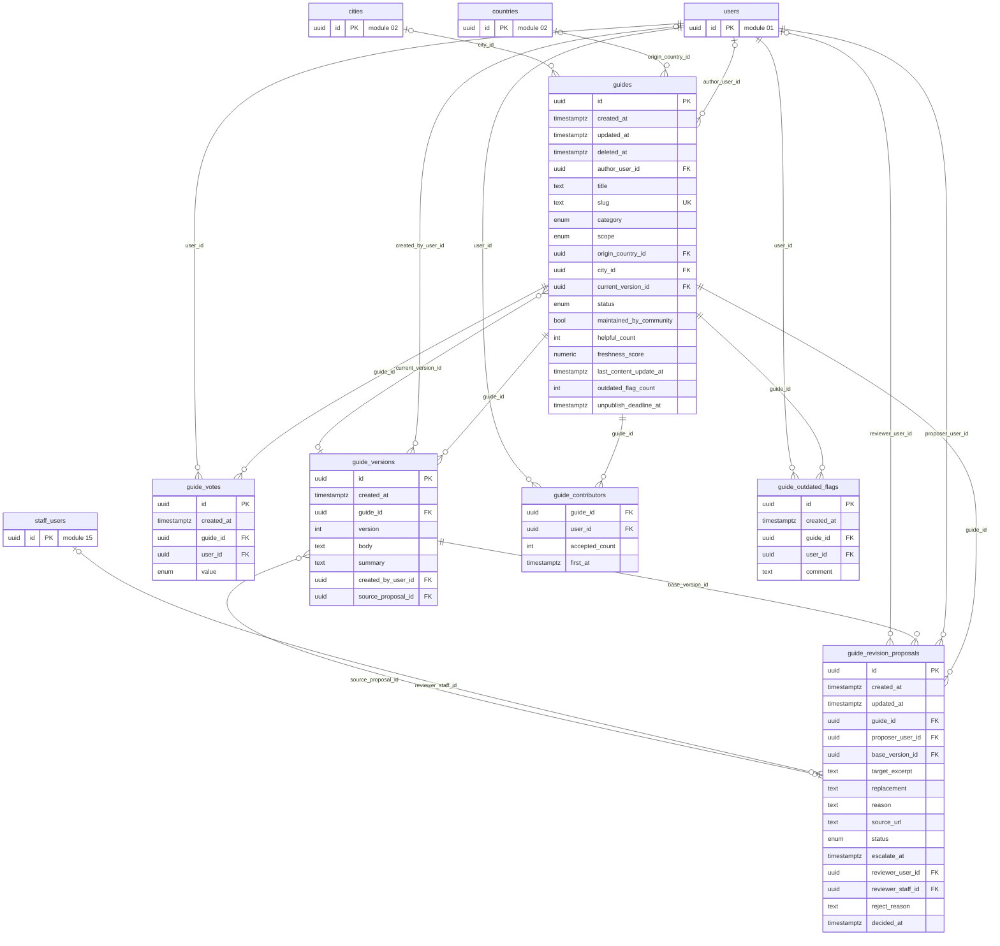


#### `guides` — socle `std+soft`

Guide rédigé par un membre. Le contenu vit dans guide_versions.

| Colonne | Type | Drapeaux | Référence | Note |
|---|---|---|---|---|
| `author_user_id` | uuid | IX | → `users.id` | Null après anonymisation |
| `title` | text | NN |  |  |
| `slug` | text | NN UQ |  |  |
| `category` | enum | NN IX |  | PRE_DEPARTURE · ARRIVAL · HOUSING · DAILY_LIFE · WORK_STUDIES · SCAM_ALERTS |
| `scope` | enum | NN |  | UNIVERSAL · COUNTRY |
| `origin_country_id` | uuid | IX | → `countries.id` | Requis si scope = COUNTRY |
| `city_id` | uuid | IX | → `cities.id` | Optionnel |
| `current_version_id` | uuid |  | → `guide_versions.id` |  |
| `status` | enum | NN IX |  | DRAFT · PUBLISHED · FLAGGED · UNPUBLISHED · ARCHIVED |
| `maintained_by_community` | bool | NN |  | Vrai après 6 mois d'inactivité de l'auteur ou anonymisation |
| `helpful_count` | int | NN |  |  |
| `freshness_score` | numeric | NN IX |  | helpful_count × coefficient de fraîcheur — recalculé chaque nuit |
| `last_content_update_at` | timestamptz | NN IX |  | Affichée aussi visiblement que le titre |
| `outdated_flag_count` | int | NN |  |  |
| `unpublish_deadline_at` | timestamptz |  |  | Fixée à 3 signalements ; dépublication si dépassée |


#### `guide_versions` — socle `append`

Historique intégral du contenu.

| Colonne | Type | Drapeaux | Référence | Note |
|---|---|---|---|---|
| `guide_id` | uuid | NN IX | → `guides.id` |  |
| `version` | int | NN |  |  |
| `body` | text | NN |  |  |
| `summary` | text |  |  | Résumé des changements |
| `created_by_user_id` | uuid |  | → `users.id` |  |
| `source_proposal_id` | uuid |  | → `guide_revision_proposals.id` |  |

> Unicité : (`guide_id`, `version`)


#### `guide_votes` — socle `append`

Vote « ça m'a aidé ». Un par membre et par guide.

| Colonne | Type | Drapeaux | Référence | Note |
|---|---|---|---|---|
| `guide_id` | uuid | NN IX | → `guides.id` |  |
| `user_id` | uuid | NN | → `users.id` |  |
| `value` | enum | NN |  | HELPFUL · NOT_HELPFUL — le négatif signale, ne déclasse pas |

> Unicité : (`guide_id`, `user_id`)


#### `guide_revision_proposals` — socle `std`

Proposition de mise à jour d'un passage, validée par le créateur.

| Colonne | Type | Drapeaux | Référence | Note |
|---|---|---|---|---|
| `guide_id` | uuid | NN IX | → `guides.id` |  |
| `proposer_user_id` | uuid | NN IX | → `users.id` |  |
| `base_version_id` | uuid | NN | → `guide_versions.id` |  |
| `target_excerpt` | text | NN |  | Passage ciblé |
| `replacement` | text | NN |  |  |
| `reason` | text | NN |  | Motif obligatoire |
| `source_url` | text |  |  |  |
| `status` | enum | NN IX |  | PENDING · ACCEPTED · AMENDED · REJECTED · ESCALATED |
| `escalate_at` | timestamptz | NN |  | created_at + 14 jours → modération |
| `reviewer_user_id` | uuid |  | → `users.id` |  |
| `reviewer_staff_id` | uuid |  | → `staff_users.id` |  |
| `reject_reason` | text |  |  |  |
| `decided_at` | timestamptz |  |  |  |


#### `guide_contributors` — socle `none`

Crédit des contributeurs d'un guide.

| Colonne | Type | Drapeaux | Référence | Note |
|---|---|---|---|---|
| `guide_id` | uuid | NN IX | → `guides.id` |  |
| `user_id` | uuid | NN | → `users.id` |  |
| `accepted_count` | int | NN |  |  |
| `first_at` | timestamptz | NN |  |  |

> Unicité : (`guide_id`, `user_id`)


#### `guide_outdated_flags` — socle `append`

Signalement « l'information a changé ». Distinct du signalement d'abus.

| Colonne | Type | Drapeaux | Référence | Note |
|---|---|---|---|---|
| `guide_id` | uuid | NN IX | → `guides.id` |  |
| `user_id` | uuid | NN | → `users.id` |  |
| `comment` | text |  |  |  |

> Unicité : (`guide_id`, `user_id`)


### Module 06 — Fil d'entraide

*Demandes typées avec état ouvert/résolu, clôture « ça m'a aidé ».*

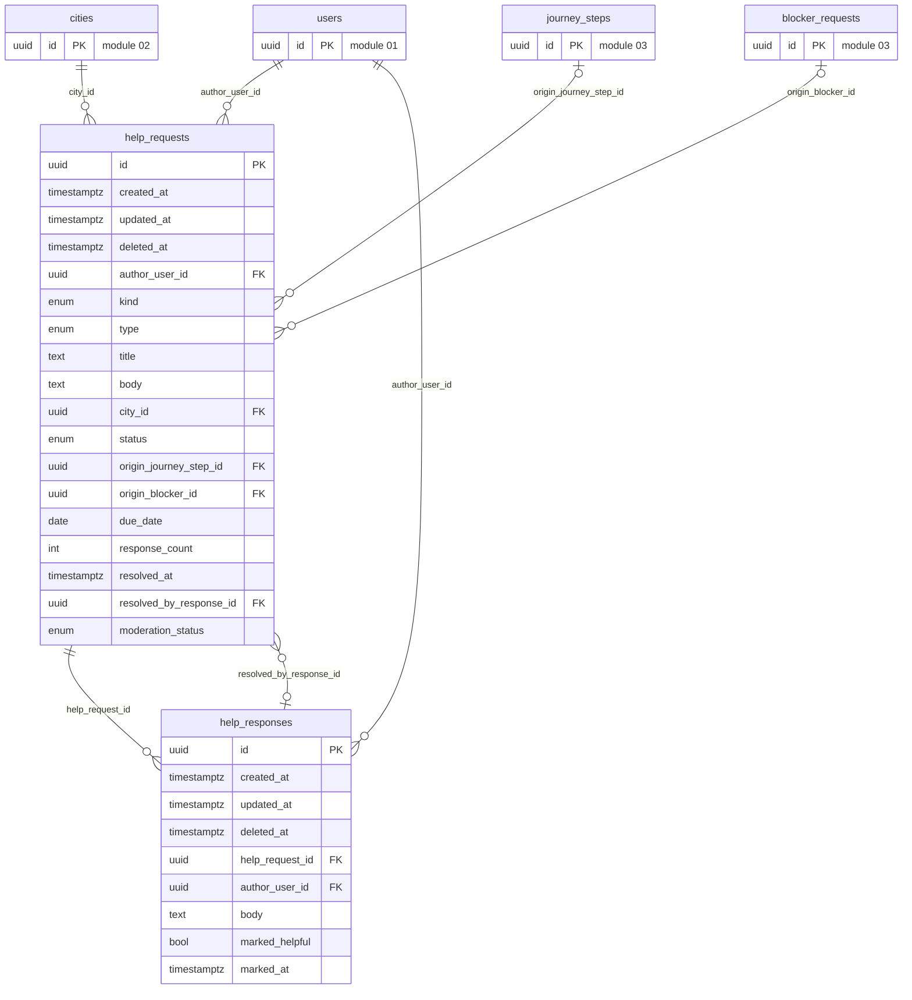


#### `help_requests` — socle `std+soft`

Demande ou offre ponctuelle, à résolution rapide.

| Colonne | Type | Drapeaux | Référence | Note |
|---|---|---|---|---|
| `author_user_id` | uuid | NN IX | → `users.id` |  |
| `kind` | enum | NN |  | REQUEST (L0+) · OFFER (L1+) |
| `type` | enum | NN IX |  | PAPERWORK · SERVICE · RIDE · MATERIAL · OTHER |
| `title` | text | NN |  |  |
| `body` | text | NN |  |  |
| `city_id` | uuid | NN IX | → `cities.id` |  |
| `status` | enum | NN IX |  | OPEN · RESOLVED · ARCHIVED |
| `origin_journey_step_id` | uuid | IX | → `journey_steps.id` | Si issue d'un « Je suis bloqué » |
| `origin_blocker_id` | uuid |  | → `blocker_requests.id` |  |
| `due_date` | date |  |  | Échéance héritée de l'étape |
| `response_count` | int | NN |  |  |
| `resolved_at` | timestamptz |  |  |  |
| `resolved_by_response_id` | uuid |  | → `help_responses.id` | Réponse marquée « ça m'a aidé » |
| `moderation_status` | enum | NN |  | PENDING · CLEARED · FLAGGED |


#### `help_responses` — socle `std+soft`

Réponse publique à une demande.

| Colonne | Type | Drapeaux | Référence | Note |
|---|---|---|---|---|
| `help_request_id` | uuid | NN IX | → `help_requests.id` |  |
| `author_user_id` | uuid | NN IX | → `users.id` |  |
| `body` | text | NN |  |  |
| `marked_helpful` | bool | NN |  | Vrai = clôture, connexion créée, réputation créditée |
| `marked_at` | timestamptz |  |  |  |


### Module 07 — Réseaux

*Réseaux automatiques (ville, pays) et d'intérêt : sujets, sondages, albums, annonces, rôles.*

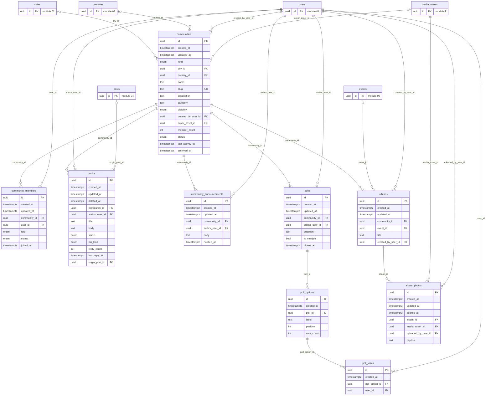


#### `communities` — socle `std`

Réseau de ville, de pays d'origine ou d'intérêt.

| Colonne | Type | Drapeaux | Référence | Note |
|---|---|---|---|---|
| `kind` | enum | NN IX |  | CITY (auto) · COUNTRY (auto) · INTEREST (membres) |
| `city_id` | uuid | IX | → `cities.id` | Requis si CITY |
| `country_id` | uuid | IX | → `countries.id` | Requis si COUNTRY |
| `name` | text | NN |  |  |
| `slug` | text | NN UQ |  |  |
| `description` | text |  |  |  |
| `category` | text |  |  | Intérêt : cuisine, sport, entrepreneuriat… |
| `visibility` | enum | NN |  | PUBLIC · ON_REQUEST · INVITE_ONLY |
| `created_by_user_id` | uuid |  | → `users.id` |  |
| `cover_asset_id` | uuid |  | → `media_assets.id` |  |
| `member_count` | int | NN |  |  |
| `status` | enum | NN IX |  | ACTIVE · ARCHIVED |
| `last_activity_at` | timestamptz | NN IX |  | Archivage auto après 60 jours (INTEREST seulement) |
| `archived_at` | timestamptz |  |  |  |


#### `community_members` — socle `std`

Appartenance et rôle.

| Colonne | Type | Drapeaux | Référence | Note |
|---|---|---|---|---|
| `community_id` | uuid | NN IX | → `communities.id` |  |
| `user_id` | uuid | NN IX | → `users.id` |  |
| `role` | enum | NN |  | OWNER · MODERATOR · MEMBER |
| `status` | enum | NN |  | ACTIVE · PENDING · INVITED · BANNED |
| `joined_at` | timestamptz |  |  |  |

> Unicité : (`community_id`, `user_id`)


#### `topics` — socle `std+soft`

Sujet persistant (structure forum, affichage cartes).

| Colonne | Type | Drapeaux | Référence | Note |
|---|---|---|---|---|
| `community_id` | uuid | NN IX | → `communities.id` |  |
| `author_user_id` | uuid | NN IX | → `users.id` |  |
| `title` | text | NN |  |  |
| `body` | text | NN |  |  |
| `status` | enum | NN IX |  | OPEN · RESOLVED · ARCHIVED |
| `pin_kind` | enum | NN |  | NONE · RULES · RESOURCE · WELCOME |
| `reply_count` | int | NN |  |  |
| `last_reply_at` | timestamptz | IX |  |  |
| `origin_post_id` | uuid |  | → `posts.id` | Question déplacée depuis le fil |


#### `community_announcements` — socle `std`

Annonce du créateur, notifiée à tous les membres.

| Colonne | Type | Drapeaux | Référence | Note |
|---|---|---|---|---|
| `community_id` | uuid | NN IX | → `communities.id` |  |
| `author_user_id` | uuid | NN | → `users.id` |  |
| `body` | text | NN |  |  |
| `notified_at` | timestamptz |  |  |  |


#### `polls` — socle `std`

Sondage de réseau.

| Colonne | Type | Drapeaux | Référence | Note |
|---|---|---|---|---|
| `community_id` | uuid | NN IX | → `communities.id` |  |
| `author_user_id` | uuid | NN | → `users.id` |  |
| `question` | text | NN |  |  |
| `is_multiple` | bool | NN |  |  |
| `closes_at` | timestamptz |  |  |  |


#### `poll_options` — socle `append`

Options d'un sondage.

| Colonne | Type | Drapeaux | Référence | Note |
|---|---|---|---|---|
| `poll_id` | uuid | NN IX | → `polls.id` |  |
| `label` | text | NN |  |  |
| `position` | int | NN |  |  |
| `vote_count` | int | NN |  |  |


#### `poll_votes` — socle `append`

Votes.

| Colonne | Type | Drapeaux | Référence | Note |
|---|---|---|---|---|
| `poll_option_id` | uuid | NN IX | → `poll_options.id` |  |
| `user_id` | uuid | NN | → `users.id` |  |

> Unicité : (`poll_option_id`, `user_id`)


#### `albums` — socle `std`

Album partagé d'un réseau, souvent lié à un événement.

| Colonne | Type | Drapeaux | Référence | Note |
|---|---|---|---|---|
| `community_id` | uuid | NN IX | → `communities.id` |  |
| `event_id` | uuid |  | → `events.id` |  |
| `title` | text | NN |  |  |
| `created_by_user_id` | uuid | NN | → `users.id` |  |


#### `album_photos` — socle `std+soft`

Photos d'un album.

| Colonne | Type | Drapeaux | Référence | Note |
|---|---|---|---|---|
| `album_id` | uuid | NN IX | → `albums.id` |  |
| `media_asset_id` | uuid | NN | → `media_assets.id` |  |
| `uploaded_by_user_id` | uuid | NN | → `users.id` |  |
| `caption` | text |  |  |  |


### Module 08 — Parrainage, contacts et messagerie

*Parrainage borné à 3 mois et 2 filleuls, contacts issus d'interactions réelles, messagerie minimale.*

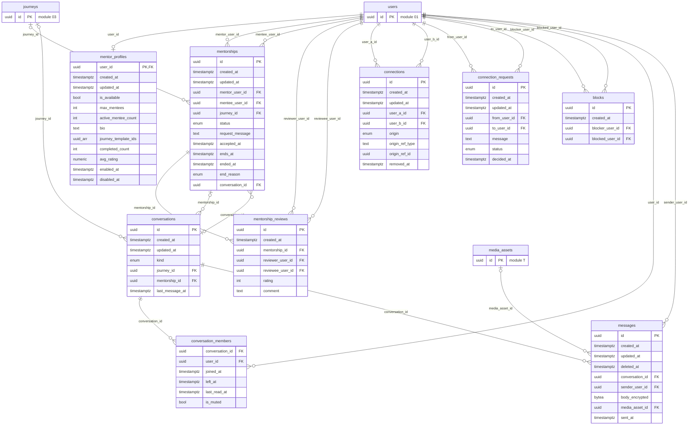


#### `mentor_profiles` — socle `pk_user`

Profil de parrain (niveau L2 requis).

| Colonne | Type | Drapeaux | Référence | Note |
|---|---|---|---|---|
| `is_available` | bool | NN IX |  |  |
| `max_mentees` | int | NN |  | Défaut 2 |
| `active_mentee_count` | int | NN |  |  |
| `bio` | text |  |  |  |
| `journey_template_ids` | uuid[] |  |  | Types de parcours qu'il connaît |
| `completed_count` | int | NN |  |  |
| `avg_rating` | numeric |  |  |  |
| `enabled_at` | timestamptz | NN |  |  |
| `disabled_at` | timestamptz |  |  |  |


#### `mentorships` — socle `std`

Relation parrain / filleul, 3 mois.

| Colonne | Type | Drapeaux | Référence | Note |
|---|---|---|---|---|
| `mentor_user_id` | uuid | NN IX | → `users.id` |  |
| `mentee_user_id` | uuid | NN IX | → `users.id` |  |
| `journey_id` | uuid |  | → `journeys.id` | Parcours du filleul |
| `status` | enum | NN IX |  | REQUESTED · ACCEPTED · DECLINED · ACTIVE · ENDED · CANCELLED |
| `request_message` | text | NN |  | Obligatoire |
| `accepted_at` | timestamptz |  |  |  |
| `ends_at` | timestamptz |  |  | accepted_at + 3 mois |
| `ended_at` | timestamptz |  |  |  |
| `end_reason` | enum |  |  | COMPLETED · MENTOR_LEFT · MENTEE_LEFT · BLOCKED · ADMIN |
| `conversation_id` | uuid |  | → `conversations.id` |  |


#### `mentorship_reviews` — socle `append`

Évaluation à la clôture, dans les deux sens.

| Colonne | Type | Drapeaux | Référence | Note |
|---|---|---|---|---|
| `mentorship_id` | uuid | NN IX | → `mentorships.id` |  |
| `reviewer_user_id` | uuid | NN | → `users.id` |  |
| `reviewee_user_id` | uuid | NN IX | → `users.id` |  |
| `rating` | int | NN |  | 1 à 5 |
| `comment` | text |  |  |  |

> Unicité : (`mentorship_id`, `reviewer_user_id`)


#### `connections` — socle `std`

Contact entre deux membres. Paire ordonnée (a < b).

| Colonne | Type | Drapeaux | Référence | Note |
|---|---|---|---|---|
| `user_a_id` | uuid | NN IX | → `users.id` |  |
| `user_b_id` | uuid | NN IX | → `users.id` |  |
| `origin` | enum | NN |  | HELP_VALIDATED · MENTORSHIP · EVENT · GUIDE · MANUAL |
| `origin_ref_type` | text |  |  |  |
| `origin_ref_id` | uuid |  |  |  |
| `removed_at` | timestamptz |  |  | Retrait automatique sur blocage |

> Unicité : (`user_a_id`, `user_b_id`)

> Contrainte : `user_a_id < user_b_id`


#### `connection_requests` — socle `std`

Demande manuelle de contact, motif obligatoire, même ville.

| Colonne | Type | Drapeaux | Référence | Note |
|---|---|---|---|---|
| `from_user_id` | uuid | NN IX | → `users.id` |  |
| `to_user_id` | uuid | NN IX | → `users.id` |  |
| `message` | text | NN |  |  |
| `status` | enum | NN |  | PENDING · ACCEPTED · DECLINED · EXPIRED |
| `decided_at` | timestamptz |  |  |  |


#### `blocks` — socle `append`

Blocage entre membres. Non notifié.

| Colonne | Type | Drapeaux | Référence | Note |
|---|---|---|---|---|
| `blocker_user_id` | uuid | NN IX | → `users.id` |  |
| `blocked_user_id` | uuid | NN IX | → `users.id` |  |

> Unicité : (`blocker_user_id`, `blocked_user_id`)


#### `conversations` — socle `std`

Fil de messages : direct, groupe de parcours, parrainage.

| Colonne | Type | Drapeaux | Référence | Note |
|---|---|---|---|---|
| `kind` | enum | NN |  | DIRECT · JOURNEY · MENTORSHIP |
| `journey_id` | uuid |  | → `journeys.id` |  |
| `mentorship_id` | uuid |  | → `mentorships.id` |  |
| `last_message_at` | timestamptz | IX |  |  |


#### `conversation_members` — socle `none`

Participants.

| Colonne | Type | Drapeaux | Référence | Note |
|---|---|---|---|---|
| `conversation_id` | uuid | NN IX | → `conversations.id` |  |
| `user_id` | uuid | NN IX | → `users.id` |  |
| `joined_at` | timestamptz | NN |  |  |
| `left_at` | timestamptz |  |  |  |
| `last_read_at` | timestamptz |  |  |  |
| `is_muted` | bool | NN |  |  |

> Unicité : (`conversation_id`, `user_id`)


#### `messages` — socle `std+soft`

Message privé, chiffré au repos.

| Colonne | Type | Drapeaux | Référence | Note |
|---|---|---|---|---|
| `conversation_id` | uuid | NN IX | → `conversations.id` |  |
| `sender_user_id` | uuid | NN IX | → `users.id` |  |
| `body_encrypted` | bytea | NN |  |  |
| `media_asset_id` | uuid |  | → `media_assets.id` |  |
| `sent_at` | timestamptz | NN IX |  |  |


### Module 09 — Villes et agenda

*Fiche ville communautaire et événements physiques — le convertisseur en ligne → réel.*

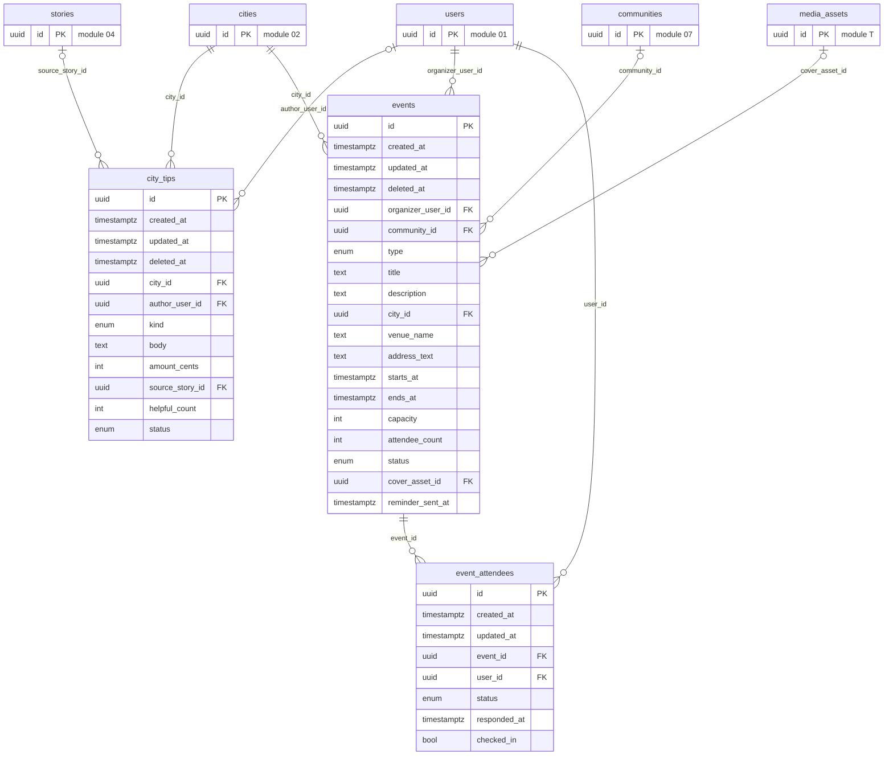


#### `city_tips` — socle `std+soft`

Contenu communautaire de la fiche ville.

| Colonne | Type | Drapeaux | Référence | Note |
|---|---|---|---|---|
| `city_id` | uuid | NN IX | → `cities.id` |  |
| `author_user_id` | uuid | IX | → `users.id` |  |
| `kind` | enum | NN IX |  | TIP · SHOP (produits du pays) · BUDGET (chiffres réels) · TESTIMONY |
| `body` | text | NN |  |  |
| `amount_cents` | int |  |  | Si BUDGET |
| `source_story_id` | uuid |  | → `stories.id` | Découverte gardée depuis une story |
| `helpful_count` | int | NN |  |  |
| `status` | enum | NN |  | PUBLISHED · HIDDEN · REMOVED |


#### `events` — socle `std+soft`

Événement physique local.

| Colonne | Type | Drapeaux | Référence | Note |
|---|---|---|---|---|
| `organizer_user_id` | uuid | NN IX | → `users.id` |  |
| `community_id` | uuid | IX | → `communities.id` | Null = public ; sinon réservé au réseau |
| `type` | enum | NN IX |  | PICNIC · SPORT · CV_WORKSHOP · COOKING · NETWORKING · OUTING · CONFERENCE · OTHER |
| `title` | text | NN |  |  |
| `description` | text |  |  |  |
| `city_id` | uuid | NN IX | → `cities.id` |  |
| `venue_name` | text |  |  |  |
| `address_text` | text |  |  | Texte libre, jamais géocodé |
| `starts_at` | timestamptz | NN IX |  |  |
| `ends_at` | timestamptz |  |  |  |
| `capacity` | int |  |  |  |
| `attendee_count` | int | NN |  |  |
| `status` | enum | NN IX |  | SCHEDULED · CANCELLED · DONE |
| `cover_asset_id` | uuid |  | → `media_assets.id` |  |
| `reminder_sent_at` | timestamptz |  |  |  |


#### `event_attendees` — socle `std`

Réponses RSVP.

| Colonne | Type | Drapeaux | Référence | Note |
|---|---|---|---|---|
| `event_id` | uuid | NN IX | → `events.id` |  |
| `user_id` | uuid | NN IX | → `users.id` |  |
| `status` | enum | NN |  | GOING · MAYBE · DECLINED · WAITLIST |
| `responded_at` | timestamptz | NN |  |  |
| `checked_in` | bool | NN |  | Alimente l'indicateur clé de participation physique |

> Unicité : (`event_id`, `user_id`)


### Module 10 — Services : logement, emploi, annuaire

*Logement (L2, score de risque), emploi, annuaire professionnel avec recommandations conditionnées au contact réel.*

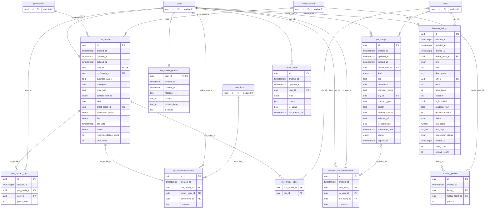


#### `housing_listings` — socle `std+soft`

Annonce ou recherche de logement. Publication réservée au niveau L2.

| Colonne | Type | Drapeaux | Référence | Note |
|---|---|---|---|---|
| `author_user_id` | uuid | NN IX | → `users.id` |  |
| `kind` | enum | NN IX |  | RENT · FLATSHARE · SUBLET · TEMPORARY · SEEKING_HOUSING · SEEKING_FLATMATE |
| `title` | text | NN |  |  |
| `description` | text | NN |  |  |
| `city_id` | uuid | NN IX | → `cities.id` |  |
| `district` | text |  |  |  |
| `price_cents` | int |  |  |  |
| `currency` | text | NN |  | EUR |
| `is_furnished` | bool |  |  |  |
| `available_from` | date | IX |  |  |
| `duration_months` | int |  |  |  |
| `status` | enum | NN IX |  | ACTIVE · PAUSED · TAKEN · EXPIRED · REMOVED |
| `risk_score` | numeric | NN IX |  | 0–1 ; prix anormalement bas = signal principal |
| `risk_flags` | text[] |  |  |  |
| `moderation_status` | enum | NN |  | PENDING · CLEARED · FLAGGED |
| `expires_at` | timestamptz | NN |  | 60 jours, renouvelable |
| `view_count` | int | NN |  |  |
| `contact_count` | int | NN |  |  |


#### `housing_photos` — socle `append`

Photos d'une annonce.

| Colonne | Type | Drapeaux | Référence | Note |
|---|---|---|---|---|
| `listing_id` | uuid | NN IX | → `housing_listings.id` |  |
| `media_asset_id` | uuid | NN | → `media_assets.id` |  |
| `position` | int | NN |  |  |


#### `job_listings` — socle `std+soft`

Offre d'emploi, stage, alternance, mission.

| Colonne | Type | Drapeaux | Référence | Note |
|---|---|---|---|---|
| `author_user_id` | uuid | NN IX | → `users.id` |  |
| `kind` | enum | NN IX |  | JOB · INTERNSHIP · APPRENTICESHIP · GIG |
| `title` | text | NN |  |  |
| `description` | text | NN |  |  |
| `company_name` | text |  |  |  |
| `city_id` | uuid | IX | → `cities.id` | Null = télétravail / national |
| `contract_type` | text |  |  |  |
| `sector` | text | IX |  |  |
| `education_level` | text |  |  |  |
| `external_url` | text |  |  |  |
| `is_sponsored` | bool | NN IX |  | Premium — mise en avant, signalée comme telle |
| `sponsored_until` | timestamptz |  |  |  |
| `status` | enum | NN IX |  | ACTIVE · EXPIRED · REMOVED |
| `expires_at` | timestamptz | NN |  |  |


#### `job_seeker_profiles` — socle `pk_user`

Membre en recherche, visible dans « profils disponibles ».

| Colonne | Type | Drapeaux | Référence | Note |
|---|---|---|---|---|
| `headline` | text | NN |  |  |
| `sectors` | text[] |  |  |  |
| `contract_types` | text[] |  |  |  |
| `is_visible` | bool | NN IX |  |  |


#### `member_recommendations` — socle `append`

Un membre recommande un autre membre pour un emploi.

| Colonne | Type | Drapeaux | Référence | Note |
|---|---|---|---|---|
| `from_user_id` | uuid | NN IX | → `users.id` |  |
| `to_user_id` | uuid | NN IX | → `users.id` |  |
| `job_listing_id` | uuid |  | → `job_listings.id` |  |
| `comment` | text |  |  |  |

> Unicité : (`from_user_id`, `to_user_id`, `job_listing_id`)


#### `pro_profiles` — socle `std+soft`

Fiche d'un membre qui exerce un métier. Niveau L2 + justificatif.

| Colonne | Type | Drapeaux | Référence | Note |
|---|---|---|---|---|
| `user_id` | uuid | NN UQ | → `users.id` |  |
| `profession_id` | uuid | NN IX | → `professions.id` |  |
| `business_name` | text |  |  |  |
| `description` | text |  |  |  |
| `price_hint` | text |  |  | Tarifs indicatifs, texte libre |
| `contact_method` | enum | NN |  | PLATFORM_MESSAGE · EMAIL · PHONE_ON_REQUEST |
| `siret` | text |  |  | Justificatif d'activité, non affiché |
| `proof_asset_id` | uuid |  | → `media_assets.id` | Justificatif, accès équipe uniquement |
| `verification_status` | enum | NN IX |  | PENDING · APPROVED · REJECTED |
| `tier` | enum | NN IX |  | FREE · PRO · PRO_PLUS |
| `tier_until` | timestamptz |  |  |  |
| `status` | enum | NN IX |  | ACTIVE · PAUSED · REMOVED |
| `recommendation_count` | int | NN |  |  |
| `view_count` | int | NN |  |  |


#### `pro_profile_cities` — socle `none`

Zones d'intervention.

| Colonne | Type | Drapeaux | Référence | Note |
|---|---|---|---|---|
| `pro_profile_id` | uuid | NN | → `pro_profiles.id` |  |
| `city_id` | uuid | NN | → `cities.id` |  |

> Unicité : (`pro_profile_id`, `city_id`)


#### `pro_recommendations` — socle `append`

Recommandation d'un pro par un membre qui a réellement interagi avec lui.

| Colonne | Type | Drapeaux | Référence | Note |
|---|---|---|---|---|
| `pro_profile_id` | uuid | NN IX | → `pro_profiles.id` |  |
| `author_user_id` | uuid | NN | → `users.id` |  |
| `connection_id` | uuid | NN | → `connections.id` | Contact obligatoire entre les deux |
| `comment` | text |  |  |  |

> Unicité : (`pro_profile_id`, `author_user_id`)


#### `pro_contact_logs` — socle `append`

Contacts d'une fiche pro. Sert au quota (3/mois en gratuit).

| Colonne | Type | Drapeaux | Référence | Note |
|---|---|---|---|---|
| `pro_profile_id` | uuid | NN IX | → `pro_profiles.id` |  |
| `user_id` | uuid | NN IX | → `users.id` |  |
| `period_key` | text | NN IX |  | AAAA-MM |


#### `saved_alerts` — socle `std`

Alertes logement / emploi personnalisées (Premium).

| Colonne | Type | Drapeaux | Référence | Note |
|---|---|---|---|---|
| `user_id` | uuid | NN IX | → `users.id` |  |
| `kind` | enum | NN |  | HOUSING · JOB |
| `criteria` | json | NN |  | Ville, budget, type… |
| `is_active` | bool | NN |  |  |
| `last_notified_at` | timestamptz |  |  |  |


### Module 11 — Recherche

*Index PostgreSQL full-text, insensible aux accents.*

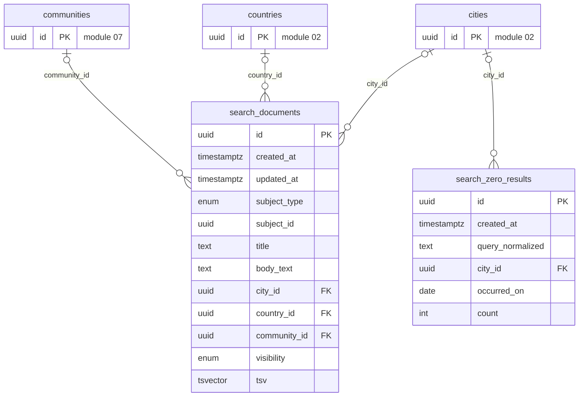


#### `search_documents` — socle `std`

Index de recherche dénormalisé. Alimenté par événements, jamais écrit à la main.

| Colonne | Type | Drapeaux | Référence | Note |
|---|---|---|---|---|
| `subject_type` | enum | NN IX |  | GUIDE · TOPIC · HELP_REQUEST · HOUSING · JOB · EVENT · USER · CITY · PRO |
| `subject_id` | uuid | NN |  |  |
| `title` | text | NN |  |  |
| `body_text` | text | NN |  |  |
| `city_id` | uuid | IX | → `cities.id` |  |
| `country_id` | uuid | IX | → `countries.id` |  |
| `community_id` | uuid | IX | → `communities.id` | Restreint aux membres du réseau si renseigné |
| `visibility` | enum | NN IX |  | PUBLIC · COMMUNITY · NONE — les parcours privés ne sont jamais indexés |
| `tsv` | tsvector | NN IX |  | unaccent + français ; index GIN |

> Unicité : (`subject_type`, `subject_id`)


#### `search_zero_results` — socle `append`

Recherches sans résultat, anonymisées. Sert au produit et à la proposition « publier la question ».

| Colonne | Type | Drapeaux | Référence | Note |
|---|---|---|---|---|
| `query_normalized` | text | NN IX |  |  |
| `city_id` | uuid |  | → `cities.id` |  |
| `occurred_on` | date | NN |  |  |
| `count` | int | NN |  |  |

> Unicité : (`query_normalized`, `city_id`, `occurred_on`)


### Module 12 — Notifications

*In-app, push PWA, email limité aux échéances critiques et au résumé hebdomadaire.*

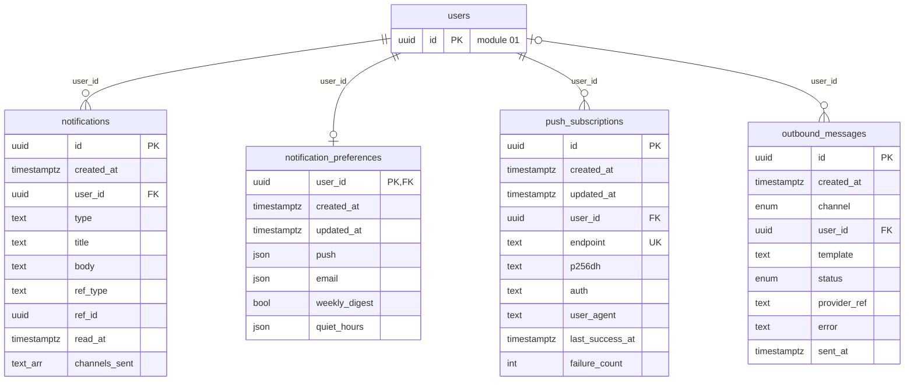


#### `notifications` — socle `append`

Notification in-app.

| Colonne | Type | Drapeaux | Référence | Note |
|---|---|---|---|---|
| `user_id` | uuid | NN IX | → `users.id` |  |
| `type` | text | NN |  | Ex. help.response_received, journey.step_due |
| `title` | text | NN |  |  |
| `body` | text |  |  |  |
| `ref_type` | text |  |  |  |
| `ref_id` | uuid |  |  |  |
| `read_at` | timestamptz | IX |  |  |
| `channels_sent` | text[] |  |  | IN_APP · PUSH · EMAIL |


#### `notification_preferences` — socle `pk_user`

Réglages par canal et par catégorie.

| Colonne | Type | Drapeaux | Référence | Note |
|---|---|---|---|---|
| `push` | json | NN |  | { catégorie: bool } |
| `email` | json | NN |  |  |
| `weekly_digest` | bool | NN |  |  |
| `quiet_hours` | json |  |  |  |


#### `push_subscriptions` — socle `std`

Abonnements Web Push.

| Colonne | Type | Drapeaux | Référence | Note |
|---|---|---|---|---|
| `user_id` | uuid | NN IX | → `users.id` |  |
| `endpoint` | text | NN UQ |  |  |
| `p256dh` | text | NN |  |  |
| `auth` | text | NN |  |  |
| `user_agent` | text |  |  |  |
| `last_success_at` | timestamptz |  |  |  |
| `failure_count` | int | NN |  | Supprimé après 5 échecs |


#### `outbound_messages` — socle `append`

Journal des envois email / SMS / push.

| Colonne | Type | Drapeaux | Référence | Note |
|---|---|---|---|---|
| `channel` | enum | NN IX |  | EMAIL · SMS · PUSH |
| `user_id` | uuid | IX | → `users.id` |  |
| `template` | text | NN |  |  |
| `status` | enum | NN IX |  | QUEUED · SENT · FAILED · BOUNCED |
| `provider_ref` | text |  |  |  |
| `error` | text |  |  |  |
| `sent_at` | timestamptz |  |  |  |


### Module 13 — Modération et sécurité

*Signalements, dossiers priorisés, pré-filtrage IA, sanctions à décision humaine, alertes arnaques.*

```mermaid
erDiagram
  users ||--o{ reports : "reporter_user_id"
  moderation_cases |o--o{ reports : "case_id"
  users |o--o{ moderation_cases : "subject_author_user_id"
  staff_users |o--o{ moderation_cases : "assigned_staff_id"
  moderation_cases ||--o{ moderation_actions : "case_id"
  staff_users |o--o{ moderation_actions : "staff_id"
  users ||--o{ sanctions : "user_id"
  staff_users ||--o{ sanctions : "issued_by_staff_id"
  moderation_cases |o--o{ sanctions : "case_id"
  cities |o--o{ scam_alerts : "city_id"
  countries |o--o{ scam_alerts : "country_id"
  staff_users ||--o{ scam_alerts : "created_by_staff_id"
  moderation_cases |o--o{ scam_alerts : "related_case_id"
  reports {
    uuid id PK
    timestamptz created_at
    uuid reporter_user_id FK
    enum subject_type
    uuid subject_id
    enum reason
    text details
    enum status
    uuid case_id FK
  }
  moderation_cases {
    uuid id PK
    timestamptz created_at
    timestamptz updated_at
    enum subject_type
    uuid subject_id
    uuid subject_author_user_id FK
    enum source
    int priority
    enum status
    enum ai_verdict
    text_arr ai_labels
    numeric ai_score
    uuid assigned_staff_id FK
    timestamptz sla_due_at
    enum resolution
    timestamptz resolved_at
  }
  moderation_actions {
    uuid id PK
    timestamptz created_at
    uuid case_id FK
    uuid staff_id FK
    enum action
    text reason
  }
  sanctions {
    uuid id PK
    timestamptz created_at
    timestamptz updated_at
    uuid user_id FK
    enum type
    text reason
    timestamptz starts_at
    timestamptz ends_at
    uuid issued_by_staff_id FK
    uuid case_id FK
    timestamptz lifted_at
  }
  scam_alerts {
    uuid id PK
    timestamptz created_at
    timestamptz updated_at
    text title
    text body
    enum severity
    uuid city_id FK
    uuid country_id FK
    bool is_pinned
    timestamptz published_at
    timestamptz expires_at
    uuid created_by_staff_id FK
    uuid related_case_id FK
  }
  ai_moderation_checks {
    uuid id PK
    timestamptz created_at
    enum subject_type
    uuid subject_id
    text model
    enum verdict
    text_arr labels
    numeric score
    bool redacted
    int latency_ms
  }
  cities {
    uuid id PK "module 02"
  }
  countries {
    uuid id PK "module 02"
  }
  staff_users {
    uuid id PK "module 15"
  }
  users {
    uuid id PK "module 01"
  }
```


#### `reports` — socle `append`

Signalement d'un membre sur un contenu ou un profil.

| Colonne | Type | Drapeaux | Référence | Note |
|---|---|---|---|---|
| `reporter_user_id` | uuid | NN IX | → `users.id` |  |
| `subject_type` | enum | NN |  | POST · COMMENT · TOPIC · GUIDE · HELP_REQUEST · HELP_RESPONSE · HOUSING · JOB · PRO · EVENT · MESSAGE · USER |
| `subject_id` | uuid | NN IX |  |  |
| `reason` | enum | NN |  | SCAM · MONEY_REQUEST · HARASSMENT · SPAM · INAPPROPRIATE · OTHER |
| `details` | text |  |  |  |
| `status` | enum | NN IX |  | NEW · ATTACHED · RESOLVED · DISMISSED |
| `case_id` | uuid | IX | → `moderation_cases.id` |  |

> Unicité : (`reporter_user_id`, `subject_type`, `subject_id`)


#### `moderation_cases` — socle `std`

Dossier de modération : regroupe signalements et détections sur un même sujet.

| Colonne | Type | Drapeaux | Référence | Note |
|---|---|---|---|---|
| `subject_type` | enum | NN |  |  |
| `subject_id` | uuid | NN IX |  |  |
| `subject_author_user_id` | uuid | IX | → `users.id` |  |
| `source` | enum | NN |  | REPORT · AI · RISK_SCORE · AUTO_RULE (ex. abus de blocage) |
| `priority` | int | NN IX |  | 1 = arnaque logement … 5 = mineur |
| `status` | enum | NN IX |  | OPEN · IN_REVIEW · RESOLVED |
| `ai_verdict` | enum |  |  | ALLOW · QUEUE · BLOCK |
| `ai_labels` | text[] |  |  |  |
| `ai_score` | numeric |  |  |  |
| `assigned_staff_id` | uuid | IX | → `staff_users.id` |  |
| `sla_due_at` | timestamptz | NN IX |  | created_at + 24 h |
| `resolution` | enum |  |  | KEEP · HIDE · REMOVE · WARN · SUSPEND |
| `resolved_at` | timestamptz |  |  |  |


#### `moderation_actions` — socle `append`

Actions prises sur un dossier. Table en ajout seul.

| Colonne | Type | Drapeaux | Référence | Note |
|---|---|---|---|---|
| `case_id` | uuid | NN IX | → `moderation_cases.id` |  |
| `staff_id` | uuid |  | → `staff_users.id` | Null si action automatique |
| `action` | enum | NN |  | HIDE · UNHIDE · REMOVE · WARN · SUSPEND_USER · BAN_USER · DISMISS · NOTE |
| `reason` | text | NN |  |  |


#### `sanctions` — socle `std`

Sanctions appliquées à un membre.

| Colonne | Type | Drapeaux | Référence | Note |
|---|---|---|---|---|
| `user_id` | uuid | NN IX | → `users.id` |  |
| `type` | enum | NN |  | WARNING · SUSPENSION · BAN |
| `reason` | text | NN |  |  |
| `starts_at` | timestamptz | NN |  |  |
| `ends_at` | timestamptz |  |  | Null = définitif |
| `issued_by_staff_id` | uuid | NN | → `staff_users.id` | Décision humaine obligatoire |
| `case_id` | uuid |  | → `moderation_cases.id` |  |
| `lifted_at` | timestamptz |  |  |  |


#### `scam_alerts` — socle `std`

Alertes arnaques épinglées, rédigées par l'équipe.

| Colonne | Type | Drapeaux | Référence | Note |
|---|---|---|---|---|
| `title` | text | NN |  |  |
| `body` | text | NN |  |  |
| `severity` | enum | NN |  | INFO · WARNING · CRITICAL |
| `city_id` | uuid |  | → `cities.id` |  |
| `country_id` | uuid |  | → `countries.id` |  |
| `is_pinned` | bool | NN IX |  |  |
| `published_at` | timestamptz | IX |  |  |
| `expires_at` | timestamptz |  |  |  |
| `created_by_staff_id` | uuid | NN | → `staff_users.id` |  |
| `related_case_id` | uuid |  | → `moderation_cases.id` |  |


#### `ai_moderation_checks` — socle `append`

Trace de chaque analyse IA (texte masqué avant envoi).

| Colonne | Type | Drapeaux | Référence | Note |
|---|---|---|---|---|
| `subject_type` | enum | NN |  |  |
| `subject_id` | uuid | NN IX |  |  |
| `model` | text | NN |  |  |
| `verdict` | enum | NN IX |  | ALLOW · QUEUE · BLOCK |
| `labels` | text[] |  |  |  |
| `score` | numeric |  |  |  |
| `redacted` | bool | NN |  | Vrai : téléphones, emails, noms masqués |
| `latency_ms` | int |  |  |  |


### Module 14 — Monétisation

*Premium 4 €/mois (carte + Mobile Money), fiches pro payantes, affiliation contextuelle par étape.*

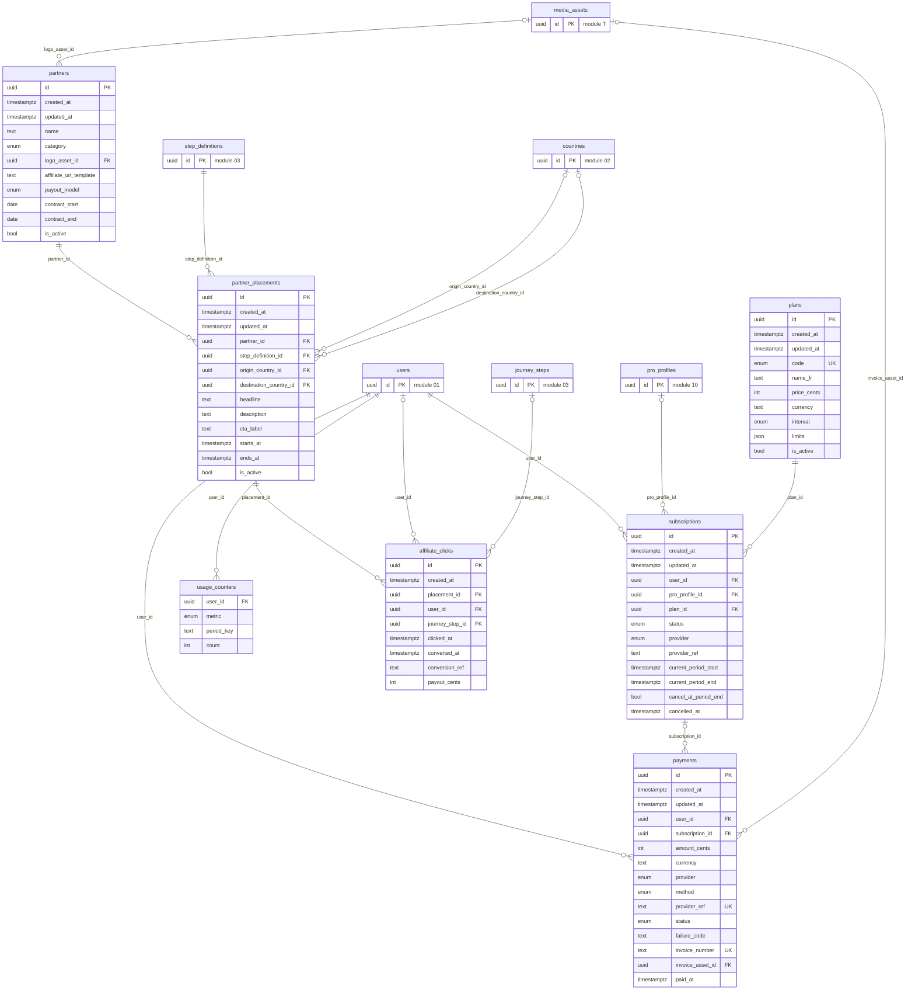


#### `plans` — socle `std`

Plans et limites.

| Colonne | Type | Drapeaux | Référence | Note |
|---|---|---|---|---|
| `code` | enum | NN UQ |  | FREE · PREMIUM · PRO · PRO_PLUS |
| `name_fr` | text | NN |  |  |
| `price_cents` | int | NN |  |  |
| `currency` | text | NN |  |  |
| `interval` | enum | NN |  | MONTH · YEAR |
| `limits` | json | NN |  | max_active_journeys, events_per_month, pro_contacts_per_month |
| `is_active` | bool | NN |  |  |


#### `subscriptions` — socle `std`

Abonnement d'un membre (Premium) ou d'une fiche pro (Pro, Pro+).

| Colonne | Type | Drapeaux | Référence | Note |
|---|---|---|---|---|
| `user_id` | uuid | NN IX | → `users.id` |  |
| `pro_profile_id` | uuid | IX | → `pro_profiles.id` | Renseigné pour PRO / PRO_PLUS |
| `plan_id` | uuid | NN | → `plans.id` |  |
| `status` | enum | NN IX |  | ACTIVE · PAST_DUE · CANCELLED · EXPIRED |
| `provider` | enum | NN |  | STRIPE · MOBILE_MONEY |
| `provider_ref` | text |  |  |  |
| `current_period_start` | timestamptz | NN |  |  |
| `current_period_end` | timestamptz | NN IX |  |  |
| `cancel_at_period_end` | bool | NN |  |  |
| `cancelled_at` | timestamptz |  |  |  |


#### `payments` — socle `std`

Paiement unitaire.

| Colonne | Type | Drapeaux | Référence | Note |
|---|---|---|---|---|
| `user_id` | uuid | NN IX | → `users.id` |  |
| `subscription_id` | uuid | IX | → `subscriptions.id` |  |
| `amount_cents` | int | NN |  |  |
| `currency` | text | NN |  | EUR · XOF |
| `provider` | enum | NN |  |  |
| `method` | enum | NN |  | CARD · MTN_MOMO · MOOV_MONEY |
| `provider_ref` | text | UQ |  |  |
| `status` | enum | NN IX |  | PENDING · SUCCEEDED · FAILED · REFUNDED |
| `failure_code` | text |  |  |  |
| `invoice_number` | text | UQ |  |  |
| `invoice_asset_id` | uuid |  | → `media_assets.id` |  |
| `paid_at` | timestamptz |  |  |  |


#### `usage_counters` — socle `none`

Compteurs mensuels pour les limites du plan gratuit.

| Colonne | Type | Drapeaux | Référence | Note |
|---|---|---|---|---|
| `user_id` | uuid | NN IX | → `users.id` |  |
| `metric` | enum | NN |  | EVENTS_CREATED · PRO_CONTACTS |
| `period_key` | text | NN |  | AAAA-MM |
| `count` | int | NN |  |  |

> Unicité : (`user_id`, `metric`, `period_key`)


#### `partners` — socle `std`

Partenaires d'affiliation.

| Colonne | Type | Drapeaux | Référence | Note |
|---|---|---|---|---|
| `name` | text | NN |  |  |
| `category` | enum | NN |  | INSURANCE · AIRLINE · BANK · REMITTANCE · HOUSING_GUARANTEE · TELECOM · OTHER |
| `logo_asset_id` | uuid |  | → `media_assets.id` |  |
| `affiliate_url_template` | text | NN |  | Contient {click_id} |
| `payout_model` | enum | NN |  | CPA · CPC · FLAT |
| `contract_start` | date |  |  |  |
| `contract_end` | date |  |  |  |
| `is_active` | bool | NN IX |  |  |


#### `partner_placements` — socle `std`

Encart partenaire sur une étape. Un seul par étape et par combinaison de pays.

| Colonne | Type | Drapeaux | Référence | Note |
|---|---|---|---|---|
| `partner_id` | uuid | NN IX | → `partners.id` |  |
| `step_definition_id` | uuid | NN IX | → `step_definitions.id` |  |
| `origin_country_id` | uuid |  | → `countries.id` |  |
| `destination_country_id` | uuid |  | → `countries.id` |  |
| `headline` | text | NN |  |  |
| `description` | text |  |  |  |
| `cta_label` | text | NN |  |  |
| `starts_at` | timestamptz |  |  |  |
| `ends_at` | timestamptz |  |  |  |
| `is_active` | bool | NN IX |  |  |

> Unicité : (`step_definition_id`, `origin_country_id`, `destination_country_id`)


#### `affiliate_clicks` — socle `append`

Clics et conversions d'affiliation.

| Colonne | Type | Drapeaux | Référence | Note |
|---|---|---|---|---|
| `placement_id` | uuid | NN IX | → `partner_placements.id` |  |
| `user_id` | uuid | IX | → `users.id` |  |
| `journey_step_id` | uuid |  | → `journey_steps.id` |  |
| `clicked_at` | timestamptz | NN |  |  |
| `converted_at` | timestamptz |  |  |  |
| `conversion_ref` | text |  |  |  |
| `payout_cents` | int |  |  |  |


### Module 15 — Administration

*Équipe, audit, feature flags, pages statiques, annonces, paramètres.*

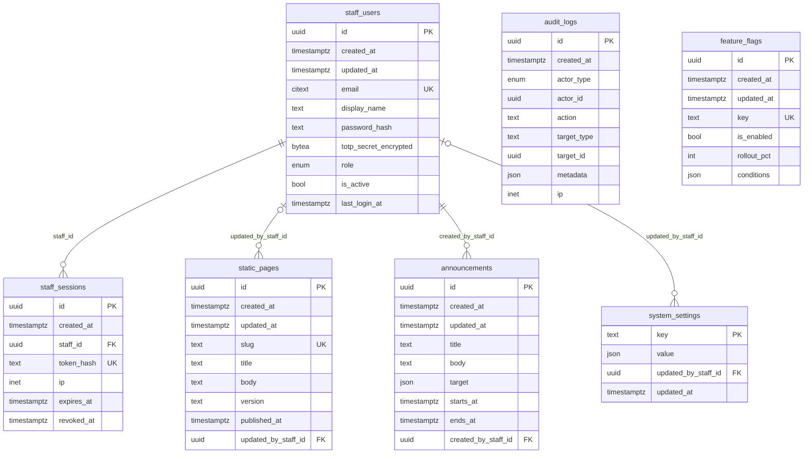


#### `staff_users` — socle `std`

Comptes de l'équipe, séparés des membres. TOTP obligatoire.

| Colonne | Type | Drapeaux | Référence | Note |
|---|---|---|---|---|
| `email` | citext | NN UQ |  |  |
| `display_name` | text | NN |  |  |
| `password_hash` | text | NN |  | argon2id |
| `totp_secret_encrypted` | bytea | NN |  |  |
| `role` | enum | NN IX |  | SUPER_ADMIN · CONTENT_ADMIN · MODERATOR · SUPPORT |
| `is_active` | bool | NN |  |  |
| `last_login_at` | timestamptz |  |  |  |


#### `staff_sessions` — socle `append`

Sessions admin.

| Colonne | Type | Drapeaux | Référence | Note |
|---|---|---|---|---|
| `staff_id` | uuid | NN IX | → `staff_users.id` |  |
| `token_hash` | text | NN UQ |  |  |
| `ip` | inet |  |  |  |
| `expires_at` | timestamptz | NN |  |  |
| `revoked_at` | timestamptz |  |  |  |


#### `audit_logs` — socle `append`

Journal d'audit. Ajout seul, jamais modifié ni supprimé.

| Colonne | Type | Drapeaux | Référence | Note |
|---|---|---|---|---|
| `actor_type` | enum | NN |  | STAFF · SYSTEM · MEMBER |
| `actor_id` | uuid | IX |  |  |
| `action` | text | NN IX |  | Ex. user.suspend, template.publish |
| `target_type` | text | NN |  |  |
| `target_id` | uuid | IX |  |  |
| `metadata` | json |  |  | Avant / après, motif — jamais de donnée sensible en clair |
| `ip` | inet |  |  |  |


#### `feature_flags` — socle `std`

Activation progressive de fonctionnalités.

| Colonne | Type | Drapeaux | Référence | Note |
|---|---|---|---|---|
| `key` | text | NN UQ |  |  |
| `is_enabled` | bool | NN |  |  |
| `rollout_pct` | int | NN |  |  |
| `conditions` | json |  |  | Villes, pays, phases |


#### `static_pages` — socle `std`

Conditions, confidentialité, règles, ressources.

| Colonne | Type | Drapeaux | Référence | Note |
|---|---|---|---|---|
| `slug` | text | NN UQ |  |  |
| `title` | text | NN |  |  |
| `body` | text | NN |  |  |
| `version` | text | NN |  | Référencée par consents.version |
| `published_at` | timestamptz |  |  |  |
| `updated_by_staff_id` | uuid |  | → `staff_users.id` |  |


#### `announcements` — socle `std`

Annonces globales ou ciblées.

| Colonne | Type | Drapeaux | Référence | Note |
|---|---|---|---|---|
| `title` | text | NN |  |  |
| `body` | text | NN |  |  |
| `target` | json |  |  | city_ids, country_ids, phases — vide = tous |
| `starts_at` | timestamptz | NN |  |  |
| `ends_at` | timestamptz |  |  |  |
| `created_by_staff_id` | uuid | NN | → `staff_users.id` |  |


#### `system_settings` — socle `none`

Paramètres modifiables sans déploiement (seuils, délais).

| Colonne | Type | Drapeaux | Référence | Note |
|---|---|---|---|---|
| `key` | text | PK NN |  |  |
| `value` | json | NN |  |  |
| `updated_by_staff_id` | uuid |  | → `staff_users.id` |  |
| `updated_at` | timestamptz | NN |  |  |


### Module T — Transverse

*Fichiers, événements de domaine, réputation, signets.*

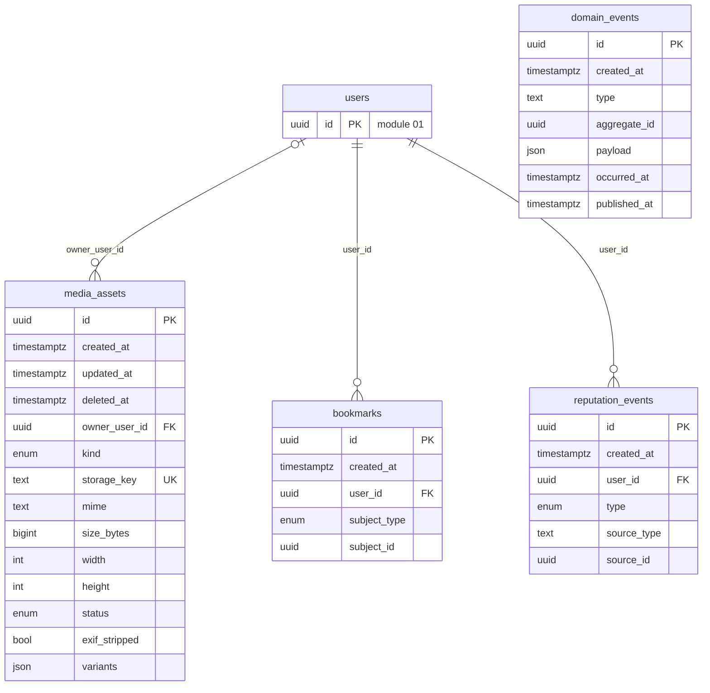


#### `media_assets` — socle `std+soft`

Tout fichier importé : avatar, photo, justificatif, export.

| Colonne | Type | Drapeaux | Référence | Note |
|---|---|---|---|---|
| `owner_user_id` | uuid | IX | → `users.id` |  |
| `kind` | enum | NN IX |  | AVATAR · POST · HOUSING · EVENT_COVER · ALBUM · MESSAGE · PROOF · LOGO · EXPORT · INVOICE |
| `storage_key` | text | NN UQ |  |  |
| `mime` | text | NN |  |  |
| `size_bytes` | bigint | NN |  |  |
| `width` | int |  |  |  |
| `height` | int |  |  |  |
| `status` | enum | NN IX |  | PENDING · SCANNING · READY · REJECTED |
| `exif_stripped` | bool | NN |  |  |
| `variants` | json |  |  | Clés des tailles générées |


#### `domain_events` — socle `append`

Boîte d'envoi transactionnelle des événements de domaine.

| Colonne | Type | Drapeaux | Référence | Note |
|---|---|---|---|---|
| `type` | text | NN IX |  | Ex. help_request.resolved |
| `aggregate_id` | uuid | NN |  |  |
| `payload` | json | NN |  |  |
| `occurred_at` | timestamptz | NN |  |  |
| `published_at` | timestamptz | IX |  |  |


#### `bookmarks` — socle `append`

Signet transverse : tout contenu enregistré « pour plus tard ». Privé, jamais compté publiquement.

| Colonne | Type | Drapeaux | Référence | Note |
|---|---|---|---|---|
| `user_id` | uuid | NN IX | → `users.id` |  |
| `subject_type` | enum | NN |  | STORY · GUIDE · POST · HELP_REQUEST · EVENT · HOUSING · JOB · PRO · MENTOR · USER · TOPIC · CITY |
| `subject_id` | uuid | NN IX |  |  |

> Unicité : (`user_id`, `subject_type`, `subject_id`)


#### `reputation_events` — socle `append`

Événements de réputation. Un événement source ne compte qu'une fois.

| Colonne | Type | Drapeaux | Référence | Note |
|---|---|---|---|---|
| `user_id` | uuid | NN IX | → `users.id` |  |
| `type` | enum | NN |  | HELP_VALIDATED · GUIDE_HELPFUL_VOTE · GUIDE_CONTRIBUTION · MENTORSHIP_COMPLETED · EVENT_ORGANIZED |
| `source_type` | text | NN |  |  |
| `source_id` | uuid | NN |  |  |

> Unicité : (`user_id`, `type`, `source_type`, `source_id`)


---

## 7. Autorisations

### 7.1 Deux axes indépendants

1. **Niveau de vérification** du membre (`L0`, `L1`, `L2`) — ce qu'il peut faire sur la plateforme.
2. **Rôle contextuel** sur un objet (auteur, membre d'un parcours, modérateur d'un réseau, parrain…) — ce qu'il peut faire sur *cet* objet.

Les rôles internes de l'équipe sont traités à part (§7.4).

### 7.2 Niveaux de vérification

| Niveau | Condition | Signification |
|---|---|---|
| **L0** | Un numéro de téléphone vérifié par OTP, quel que soit le pays autorisé | Compte existant. Typiquement un membre encore en Afrique |
| **L1** | L0 + identité vérifiée par Didit (statut `APPROVED`) | Personne réelle, majeure, identifiée |
| **L2** | L1 + un numéro de téléphone d'un **pays de destination actif** vérifié par OTP (`phone_numbers.is_destination`) | Personne réelle présente sur le territoire |

**Règles de calcul :**
- Les niveaux sont **cumulatifs**. Un numéro français sans KYC reste L0.
- Le niveau est stocké dénormalisé sur `users.verification_level`, recalculé à chaque événement `kyc.status_changed`, `phone.added`, `phone.removed`.
- Au changement de niveau, toutes les sessions du membre sont marquées `level_refresh_required` : le prochain appel force un nouveau jeton d'accès (le niveau figure dans le jeton).
- Un KYC refusé ou expiré fait retomber le membre à L0, même s'il a un numéro français.

### 7.3 Matrice des capacités

Source unique dans `packages/shared`. Le back l'applique par un décorateur sur chaque route ; le front l'utilise pour afficher ou masquer, **jamais comme seule protection**.

| Capacité | L0 | L1 | L2 | Limite de plan |
|---|:-:|:-:|:-:|---|
| `content.read` — lire fil, guides, entraide, réseaux, annonces | ✓ | ✓ | ✓ | — |
| `journey.create` — créer un parcours | ✓ | ✓ | ✓ | 1 actif en gratuit, illimité en Premium |
| `journey.manage` — éditer ses étapes, cocher, inviter | ✓ | ✓ | ✓ | — |
| `comment.create` — commenter, réagir | ✓ | ✓ | ✓ | — |
| `help.ask` — publier une **question** d'entraide | ✓ | ✓ | ✓ | — |
| `mentorship.request` — demander un parrain | ✓ | ✓ | ✓ | — |
| `post.create` — publier dans le fil | | ✓ | ✓ | — |
| `help.offer` — publier une **offre** d'entraide | | ✓ | ✓ | — |
| `guide.write` — rédiger un guide | | ✓ | ✓ | — |
| `guide.vote` — voter « ça m'a aidé » | | ✓ | ✓ | — |
| `guide.propose_revision` | | ✓ | ✓ | — |
| `event.create` | | ✓ | ✓ | 1 par mois en gratuit, illimité en Premium |
| `event.attend` — RSVP | | ✓ | ✓ | — |
| `community.create` | | ✓ | ✓ | — |
| `message.send` — messagerie privée | | ✓ | ✓ | — |
| `connection.request` | | ✓ | ✓ | — |
| `job.publish` | | ✓ | ✓ | Sponsorisée : Premium |
| `pro.contact` — contacter une fiche pro | | ✓ | ✓ | 3 par mois en gratuit, illimité en Premium |
| `housing.publish` — publier une annonce logement | | | ✓ | — |
| `mentor.become` — devenir parrain | | | ✓ | — |
| `pro.register` — se référencer dans l'annuaire | | | ✓ | + justificatif d'activité |

**[RÈGLE DURE]** Toute route d'écriture déclare une capacité requise. Un test d'intégration parcourt toutes les routes et échoue si une route non-GET n'en déclare pas.

**Réponse quand le niveau manque :** `403` avec `code: LEVEL_REQUIRED` et `details` contenant le niveau requis, le niveau actuel et la capacité. Le front affiche alors une invitation à monter de niveau, jamais une simple erreur.

**Membre suspendu :** toutes les capacités d'écriture sont retirées, `code: ACCOUNT_SUSPENDED`.

### 7.4 Rôles internes (équipe)

Les comptes de l'équipe sont des `staff_users`, **séparés** des comptes membres. Connexion par email + mot de passe (argon2id) + **TOTP obligatoire**.

| Rôle | Périmètre |
|---|---|
| `SUPER_ADMIN` | Tout, y compris rôles et paramètres de paiement |
| `CONTENT_ADMIN` | Modèles de parcours, référentiels, pages, annonces |
| `MODERATOR` | File de modération, sanctions sauf bannissement définitif |
| `SUPPORT` | Lecture des fiches membres, traitement RGPD |

Les **modérateurs bénévoles** issus des membres sont un rôle contextuel (`community_members.role = MODERATOR`), pas un compte équipe.

**[RÈGLE DURE]** Toute action admin écrit une ligne dans `audit_logs`.

---

## 8. Sécurité et RGPD

### 8.1 Minimisation

| Donnée | Traitement |
|---|---|
| Pièce d'identité, selfie | **Jamais reçus ni stockés.** Didit les traite ; on ne conserve que statut, date de décision et booléen de majorité |
| Position | Jamais collectée. Maille minimale : ville |
| Numéro de téléphone | Chiffré au repos (AES-256-GCM) + empreinte HMAC-SHA256 pour l'unicité et la recherche. **Jamais affiché** à un autre membre |
| Photos | Métadonnées EXIF supprimées à l'import (elles contiennent souvent la position GPS) |
| Parcours | Privé par défaut. Notes personnelles d'étape chiffrées au repos |
| Messages privés | Chiffrés au repos. Pas de chiffrement de bout en bout en V1 : la modération doit pouvoir traiter un signalement |
| Justificatif d'activité pro | Stocké, accès équipe uniquement, jamais affiché |

### 8.2 Hébergement et sous-traitants

**[RÈGLE DURE]** Toutes les données (base, fichiers, sauvegardes, journaux) sont hébergées dans l'Union européenne. Les sous-traitants hors UE (Twilio, Stripe, Anthropic, Didit) sont listés dans la politique de confidentialité avec leur base juridique de transfert.

**Modération IA :** les textes envoyés à l'API sont **débarrassés des numéros de téléphone, adresses email et noms propres détectés** avant l'envoi. `ai_moderation_checks.redacted` en garde la trace.

### 8.3 Protection applicative

- Mots de passe (équipe uniquement) : argon2id.
- En-têtes : CSP stricte, HSTS, `X-Content-Type-Options`, `Referrer-Policy: strict-origin-when-cross-origin`.
- Cookies : `HttpOnly`, `Secure`, `SameSite=Lax` ; `Strict` pour le jeton de rafraîchissement. Protection CSRF sur les routes qui l'utilisent.
- Fichiers importés : type réel vérifié (octets magiques), taille maximale, analyse antivirus dans le worker avant publication (`media_assets.status`).
- Toutes les entrées validées ; toutes les requêtes paramétrées.
- Captcha (Cloudflare Turnstile) sur l'envoi d'OTP.

### 8.4 Durées de conservation

| Donnée | Durée |
|---|---|
| Défis OTP | 24 h |
| Sessions expirées | 30 jours |
| Contenus d'un compte supprimé | Supprimés, sauf guides et réponses utiles : **anonymisés** |
| Signalements traités | 3 ans |
| Journal d'audit | 5 ans |
| Journaux applicatifs | 90 jours |
| Données de paiement | Selon obligations comptables (10 ans pour les factures) |

Une tâche quotidienne `retention.purge` applique ces durées.

### 8.5 Journal d'audit

Table `audit_logs`, en ajout seul : aucune route de modification ou de suppression. Alimentée par tout service admin et par les actions système sensibles (suspension automatique, dépublication).

### 8.6 Suppression de compte — architecture

Chaque module qui stocke des données liées à un membre déclare un **gestionnaire de suppression** : une fonction idempotente qui supprime ou anonymise les données de ce membre dans les tables du module. La tâche de suppression (`01-identite.md`) exécute tous les gestionnaires dans une même transaction. Chaque fichier de module précise le comportement du sien.

---

## 9. Événements de domaine et tâches planifiées

### 9.1 Patron « boîte d'envoi »

Un service qui modifie l'état écrit, **dans la même transaction**, une ligne dans `domain_events`. Un relais (tâche toutes les secondes) publie ces événements dans la file `events` et les marque publiés. Cela garantit qu'aucun effet de bord n'est perdu ni exécuté pour une écriture annulée.

Nommage : `<entité>.<verbe_passé>` — `journey.step_completed`, `guide.voted`, `mentorship.ended`, `kyc.status_changed`.

### 9.2 Files

| File | Rôle |
|---|---|
| `events` | Distribution des événements de domaine aux abonnés |
| `notifications` | Création et envoi des notifications |
| `email` · `sms` · `push` | Envois sortants, réessais exponentiels, trace dans `outbound_messages` |
| `moderation` | Analyse IA des contenus |
| `search-index` | Mise à jour de `search_documents` |
| `media` | Redimensionnement, suppression EXIF, antivirus |
| `scheduled` | Tâches planifiées |

### 9.3 Tâches planifiées

| Tâche | Fréquence | Module |
|---|---|---|
| `outbox.relay` | 1 s | transverse |
| `journey.reminders` — échéances d'étapes | toutes les heures | 03 |
| `journey.inactivity_check` — relance unique après 60 jours | quotidienne | 03 |
| `guide.freshness_recompute` | quotidienne | 05 |
| `guide.proposal_escalation` — 14 jours sans réponse | quotidienne | 05 |
| `guide.outdated_unpublish` — 30 jours après 3 signalements | quotidienne | 05 |
| `guide.author_inactivity` — 6 mois | hebdomadaire | 05 |
| `community.archive_inactive` — 60 jours | quotidienne | 07 |
| `mentorship.end_due` — 3 mois | quotidienne | 08 |
| `event.reminders` | toutes les 15 min | 09 |
| `listing.expire` — logement 60 jours, emploi 45 jours | quotidienne | 10 |
| `story.expire` | 5 min | 04 |
| `story.score_recompute` | 15 min | 04 |
| `story.purge_history` — 30 jours après expiration, sauf enregistrées | quotidienne | 04 |
| `bookmark.state_refresh` | horaire | transverse |
| `notifications.weekly_digest` | lundi 8 h (Europe/Paris) | 12 |
| `user.phase_progression` — RECENT_ARRIVAL → SETTLED après 6 mois | quotidienne | 01 |
| `account.deletion_execute` — après 7 jours | toutes les heures | 01 |
| `city.member_count_recompute` | quotidienne | 02 |
| `billing.expiry_reminders` | quotidienne | 14 |
| `retention.purge` | quotidienne | transverse |

Toutes les tâches sont **idempotentes** et protégées par un verrou Redis.

### 9.4 Réputation

Pas de score unique : des **compteurs par type** dans `user_stats`, alimentés par `reputation_events`. La contrainte d'unicité (membre, type, source) garantit qu'un événement source ne compte qu'une fois. Un vote retiré supprime l'événement et décrémente le compteur. Jamais de classement de popularité.

---

## 10. Front-end

### 10.1 Structure d'écran

**Ordinateur (≥ 1024 px) — trois colonnes de navigation :**

| Zone | Largeur | Contenu |
|---|---|---|
| Rail d'icônes | 76 px, fixe | Logo · Accueil · Parcours · Entraide · Services · Agenda · *(bas)* réglages |
| Panneau de section | 264 px | Menu de la section active |
| Barre haute | largeur restante, 62 px | Recherche · Créer (+) · Messages · Notifications · Avatar |
| Contenu | max 660 px | Page |
| Colonne droite | 300 px, masquée < 1280 px | Contexte de la page |

**Panneaux de section :** même grammaire pour tous — une carte contextuelle en haut, des sections titrées avec compteurs, un bloc en bas.

| Icône | Carte du haut | Sections | Bloc du bas |
|---|---|---|---|
| **Accueil** | Profil (avatar, nom, « Voir mon profil public ») puis carte **Mon parcours** (vert foncé : nom donné par le membre, %, barre, étape en cours, Continuer ; variante « Créer mon parcours ») | **COMMUNAUTÉ** : Fil d'actualité · Guides & Démarches · Fil d'entraide `nouveautés` · Réseaux · Parrainage · Villes & Membres · Événements `nouveautés` | **VOS RACCOURCIS** : mes réseaux (pastille, nom, membres) · Modifier |
| **Parcours** | Sélecteur si plusieurs · nom · % · barre · étape en cours · bouton **Je suis bloqué·e** | **MON PARCOURS** : Vue d'ensemble · Étape en cours · Discussion `n` · Équipe `n` · Checklist de documents · Historique · Réglages — **PARCOURS PUBLICS** : 5 parcours publics d'autres membres, même type en priorité (avatar, nom, type · ville, mini-barre) · Voir tous | **RAPPELS** : échéances à venir |
| **Entraide** | **Ma réputation** : grand chiffre d'entraides validées, ligne guides · parrainages · événements | **ENTRAIDE** : Toutes les demandes `ouvertes ville` · Vous pouvez aider `n` · Mes demandes · Mes réponses — **PARRAINAGE** : Trouver un parrain · Mes parrainages `n` · Devenir parrain | Encart terre cuite doux : règle de non-paiement · Signaler |
| **Services** | **Mes quotas du mois** : contacts pro `2/3` avec barre · lien Premium | **SERVICES** : Annonces logement `actives ville` · Bourses & emploi `n` · Annuaire professionnel — **MON ESPACE** : Mes annonces `n` · Mes alertes `PREMIUM` · Ma fiche pro (état) | Encart vert doux « Vous exercez un métier ? » · Créer ma fiche pro |
| **Agenda** | Mois en cours, flèches ‹ ›, aujourd'hui en évidence | **CALENDRIER** : colonne verticale de jours groupés par semaine — `SAM 21` · titre du premier événement · point vert = événements près de moi · **point terre cuite = j'y participe** ; jours sans événement présents mais atténués ; jour sélectionné en fond vert doux | Bouton « Créer un événement » · quota du mois |

**Bandeau du fil :** en haut du fil d'actualité, les stories du jour (informations par fraîcheur, conseils par score, découvertes par « À voir »), première bulle « Créer une story ». Le bandeau de jalons n'existe plus ; le partage de jalon se fait depuis le parcours.

**Règle des compteurs :** dans le panneau Accueil, un compteur est un nombre de **nouveautés depuis la dernière visite** ; dans les panneaux de section, c'est un **total**.

**Page Agenda :** les événements du jour sélectionné — ceux où le membre participe en tête et marqués, puis les autres près de chez lui et dans ses réseaux. Chips : Tous · Mes participations · Mes organisations. Ouverture sur aujourd'hui, ou sur le prochain jour avec événement.

**Mobile (< 1024 px) :** barre d'onglets basse à cinq entrées (Accueil, Parcours, Entraide, Services, Compte). Le panneau de section devient une barre d'onglets secondaire horizontale en haut de page ; pour l'Agenda, une **bande horizontale de dates** défilante. Agenda est accessible depuis Accueil.

**[RÈGLE DURE]** La navigation principale n'est jamais une barre d'icônes horizontale en haut d'écran sur ordinateur.

### 10.2 Jetons de design

| Jeton | Valeur | Usage |
|---|---|---|
| Primaire | `#16785E` | Actions, éléments actifs, badge de vérification |
| Primaire fort | `#0F5C48` | Rail de navigation, survol, titres |
| Primaire doux | `#E3F0EB` | Fonds de pastille, encarts |
| Primaire alternatif | `#2FA37D` | Accents légers |
| **Parcours** | `#E0733A` | **Réservé** : étape en cours, jalon, échéance, barre de progression, badge Premium |
| Parcours doux | `#FBE3D4` | Fonds terre cuite |
| Parcours fort | `#B4581F` | Texte terre cuite sur fond clair |
| Fond | `#F2F4F3` | Arrière-plan général |
| Surface | `#FFFFFF` | Cartes |
| Bordure | `#E0E5E3` | 1 px, jamais d'ombre |
| Texte | `#16211D` · `#5D6B66` · `#8A958F` | Principal · secondaire · tertiaire |
| Rayons | 10 · 14 · 16 px | Boutons · cartes · grandes cartes |
| Cible tactile | 44 px minimum | Tout élément cliquable |
| Police | Plus Jakarta Sans | Corps 14–15 px, titres 25–30 px |

**[RÈGLE DURE]** La couleur parcours n'est utilisée que pour les usages listés. Un contrôle automatique signale tout autre emploi.

Icônes en trait fin 1,7 px (Lucide). Aucun emoji dans l'interface elle-même.

### 10.3 Données et état

- Tout appel API passe par un client typé généré depuis l'OpenAPI.
- Une ressource = un fichier de hooks. Mises à jour optimistes pour : réactions, votes, cocher une étape, RSVP.
- Rendu serveur pour les pages publiques ; zone connectée en rendu client après authentification.

### 10.4 PWA

- Manifeste : nom `afroexpates`, couleur de thème `#0F5C48`, mode autonome.
- Service worker : coquille applicative en cache, page hors ligne, **aucune donnée personnelle en cache persistant**.
- Push : demande de permission **uniquement après une action explicite du membre**.

### 10.5 Textes

Tous les textes d'interface dans un fichier de traduction par module. **Aucune chaîne en dur dans les composants.** Vouvoiement, phrases courtes, écriture inclusive au point médian uniquement quand un accord est inévitable.

### 10.6 Accessibilité

Cible tactile 44 px · contraste AA · navigation clavier complète · nom accessible sur tout élément interactif · contrôle automatisé (axe-core) sur chaque page principale.

---

## 11. Environnements et intégration continue

### 11.1 Environnements

| Environnement | Rôle |
|---|---|
| `local` | Conteneurs : PostgreSQL, Redis, S3 local, boîte mail locale, antivirus. Fournisseurs externes simulés |
| `staging` | Copie de production avec données synthétiques. Fournisseurs en mode test (Didit sandbox, Stripe test) |
| `production` | UE uniquement |

### 11.2 Configuration

Toute configuration passe par des variables d'environnement, validées au démarrage ; l'application refuse de démarrer si une variable manque. Secrets à prévoir : signature des jetons, chiffrement des téléphones et des contenus, accès S3, Twilio, Brevo, VAPID, Didit (clé API, secret webhook, identifiant de workflow), Stripe, Mobile Money, Anthropic, Turnstile, Sentry.

### 11.3 Simulation des fournisseurs

Chaque fournisseur externe est derrière une interface avec une implémentation **fictive** en local et en test : SMS fictif (code OTP fixe et journalisé), KYC fictif (page locale pour choisir le résultat), paiement fictif (succès immédiat).

### 11.4 Intégration continue

À chaque requête de fusion : installation → lint → vérification de types → tests unitaires → tests d'intégration → vérification que les migrations sont à jour → build → tests de bout en bout.

**Parcours critiques couverts de bout en bout :**
1. Inscription par OTP → onboarding complet → arrivée sur le parcours créé
2. Cocher une étape → « Je suis bloqué » → relire → publier → demande visible dans l'entraide
3. Répondre à une demande → « ça m'a aidé » → contact créé
4. Vérification KYC (fictive) → passage en L1 → publication dans le fil
5. Ajout du numéro français → passage en L2 → publication d'une annonce logement
6. Signalement → apparition dans la file de modération admin
7. Souscription Premium (fictive) → levée de la limite de parcours

### 11.5 Couverture

Services : 80 % minimum. **Toute [RÈGLE DURE] a un test dédié.**

---

## 12. Ordre de construction et définition de « terminé »

### 12.1 Lots

| Lot | Contenu | Fichiers |
|---|---|---|
| **1. Socle** | Monorepo, CI, base, auth OTP, profil, niveaux, référentiels, layout, audit | 00, 01, 02 |
| **2. Parcours** | Modèles, back-office des modèles, parcours membre, rétro-planning, checklist | 03, 15 |
| **3. Communauté** | Fil, commentaires, réactions, jalons | 04 |
| **4. Entraide** | Demandes, réponses, « Je suis bloqué » branché | 06 |
| **5. Confiance** | KYC Didit, modération, signalements, blocage | 01, 13 |
| **6. Savoir** | Guides, votes, propositions de mise à jour | 05 |
| **7. Lien** | Réseaux, parrainage, contacts, messagerie | 07, 08 |
| **8. Local** | Villes, agenda | 02, 09 |
| **9. Services** | Logement, emploi, annuaire pro | 10 |
| **10. Transverse** | Recherche, notifications, résumé hebdomadaire | 11, 12 |
| **11. Revenus** | Premium, Mobile Money, partenaires, affiliation | 14 |
| **12. Pilotage** | Tableaux de bord, rapport d'impact | 15 |

Chaque lot est livrable et testable seul. Un lot ne commence que lorsque le précédent passe la CI.

### 12.2 Définition de « terminé »

Une fonctionnalité est terminée quand **toutes** ces conditions sont réunies :

- [ ] Tables et migrations conformes à la section 6, avec index sur toutes les colonnes de filtre et de tri
- [ ] Schémas de validation dans `packages/shared`
- [ ] Permissions vérifiées dans le service (capacité + rôle contextuel)
- [ ] Routes documentées dans l'OpenAPI, avec codes d'erreur
- [ ] Effets de bord passant par des événements de domaine
- [ ] Gestionnaire de suppression de compte implémenté si le module stocke des données membres
- [ ] Interface avec les états : chargement, vide, erreur, succès, **permission insuffisante**
- [ ] Textes dans les fichiers de traduction, aucune chaîne en dur
- [ ] Tests unitaires du service, test d'intégration de chaque route, test de chaque [RÈGLE DURE]
- [ ] Contrôle d'accessibilité sans violation
- [ ] Entrée dans `docs/decisions.md` pour toute hypothèse prise
